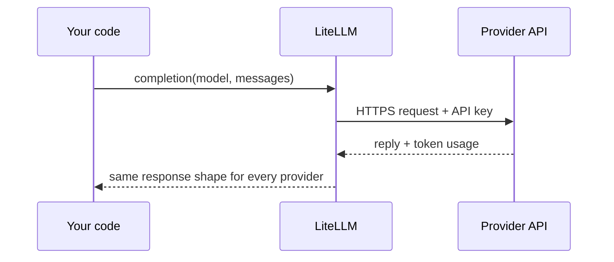

# Calling an LLM from code

## In one sentence

Your program sends a list of messages to a provider's **API** over HTTPS, along with an API key, and gets back the model's reply plus a count of the tokens it used.

## Why it matters in 2027

Every AI application, agent framework and coding agent is a loop around this one call. Knowing what goes in and out (messages, parameters, token usage, errors) lets you debug frameworks instead of guessing, control cost, and switch providers when prices or models change.

## Explain it like I'm new

Ordering food through a delivery app. You send an order (your messages) with your account details (API key). The kitchen (the provider) cooks it and sends it back with a bill (token usage). Sometimes the kitchen is busy and tells you to try again in a minute (a rate-limit error).

Where the analogy stops working: you can ask the kitchen to deliver the food bite by bite as it's cooked. That's **streaming**, and chat apps use it so text appears as it's written.

## How it works

A request contains:

- **model**: which model to use, e.g. `gemini-3.5-flash-lite`.
- **messages**: the conversation, each with a role (`system`, `user`, `assistant`, `tool`). See [prompting basics](prompting-basics.md).
- **parameters**: `temperature`, `max_tokens` (the output limit), and optionally `tools` (functions the model may ask you to call) or a response schema for structured JSON.

A response contains the reply text (or a tool-call request), a **finish reason** (finished normally, hit the token limit, or wants a tool) and **usage**: input and output token counts, which is what you're billed on.

Each provider has its own API format. Libraries like **LiteLLM** give you one function that works across OpenAI, Anthropic, Google Gemini, local models via Ollama and many others, so switching provider is a one-line change. All projects in this playbook use LiteLLM with Gemini as the default, because Google's free tier lets you learn without a credit card.



> [!CAUTION]
> Never hard-code an API key or commit it to Git. Read it from an environment variable or a `.env` file listed in `.gitignore`. Leaked keys get found by bots within minutes and can be used to run up your bill.

## Example

1. Get a free API key from [Google AI Studio](https://aistudio.google.com/apikey).
2. Run:

```python
# export GEMINI_API_KEY=...   then:   uv run --with litellm python hello.py
from litellm import completion

resp = completion(
    model="gemini/gemini-3.5-flash-lite",
    messages=[
        {"role": "system", "content": "You explain things to beginners in two sentences."},
        {"role": "user", "content": "What is an API?"},
    ],
    temperature=0.2,
    max_tokens=200,
)
print(resp.choices[0].message.content)
print(resp.usage)  # prompt_tokens, completion_tokens, total_tokens
```

To use another provider, change only the model string and the key: `openai/gpt-...` with `OPENAI_API_KEY`, `anthropic/claude-...` with `ANTHROPIC_API_KEY`, or `ollama/llama3.2` for a free local model with no key at all.

## Common mistakes

- **No retries.** Rate-limit (429) and server (5xx) errors are normal. Retry with exponential backoff, which LiteLLM can do for you (`num_retries=3`).
- **No timeouts.** A hung request can freeze your app. Always set one.
- **Ignoring usage.** Log token counts from day one so cost surprises show up early (see [cost and latency](../07-agent-ops-production/cost-and-latency.md)).
- **Pinning to "latest".** Model aliases change behavior when the provider updates them. Pin a specific model version in production and test before upgrading.
- **Parsing free text.** If code needs fields, ask for structured output and validate it.

## Check yourself

1. What three things does every chat request need?
2. What does the `usage` field tell you, and why log it?
3. What should your code do when it gets an HTTP 429 response?

<details>
<summary>Answers</summary>

1. A model name, a list of messages, and an API key (sent as a header).
2. How many input and output tokens the call used. That's what you pay for, so logging it lets you track and control cost.
3. Wait and retry, with an increasing delay between attempts (exponential backoff), and give up after a few tries.

</details>

## Go deeper

- [Gemini API quickstart](https://ai.google.dev/gemini-api/docs/quickstart) by Google - Get a key and make your first call. *Beginner · Docs · 10 min*
- [LiteLLM documentation](https://docs.litellm.ai/docs/) - One interface for 100+ providers, plus retries and fallbacks. *Beginner · Docs · 20 min*
- [Gemini API rate limits](https://ai.google.dev/gemini-api/docs/rate-limits) by Google - What the free tier allows and how limits are counted. *Beginner · Docs · 5 min*
