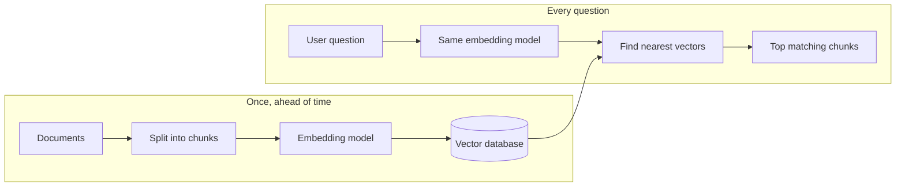

# Embeddings and vector search

## In one sentence

An **embedding** is a list of numbers that represents the meaning of a piece of text, so that texts with similar meanings get similar numbers, and **vector search** finds the stored texts whose numbers are closest to a question's.

## Why it matters in 2027

Embeddings power search, recommendations, deduplication and, above all, [RAG](rag-in-one-page.md), the most common way to give an LLM your own data. They also carry their own security risks: poisoned documents, leaked data between customers, and attacks that recover text from vectors (see [vector and embedding weaknesses](../04-llm-security/vector-and-embedding-weaknesses.md)).

## Explain it like I'm new

Picture a huge library where books aren't sorted by title but by topic, placed in a giant room so that books about similar things sit close together. Cooking books cluster in one corner, with Italian cooking near pasta-making. An embedding is a book's coordinates in that room. To find books about "how to make fresh noodles", you work out where that question would sit and grab the nearest books, even if none of them contains the word "noodles".

Where the analogy stops working: the real room has hundreds or thousands of dimensions, not three.

## How it works



1. **Chunk.** Split documents into passages of a few hundred tokens. Chunks that are too big blur several topics together. Chunks that are too small lose context.
2. **Embed.** Send each chunk to an embedding model (for example Google's `gemini-embedding-001` or OpenAI's `text-embedding-3-small`). You get back a vector, often 768 to 3,072 numbers long.
3. **Store.** Save the vectors with the original text and metadata (source, date, owner) in a **vector database** such as pgvector, Chroma, Qdrant or Pinecone.
4. **Search.** Embed the question with the same model and find the stored vectors with the highest **cosine similarity** (a measure of how closely two vectors point in the same direction, from -1 to 1).

Many production systems combine vector search with old-fashioned keyword search (called **hybrid search**). Exact matches for product codes, names and error messages are something embeddings handle poorly.

## Example

```python
# uv run --with litellm --with numpy python similarity.py   (needs GEMINI_API_KEY)
import numpy as np
from litellm import embedding

texts = ["How do I reset my password?", "I forgot my login details", "Best pizza in Delhi"]
resp = embedding(model="gemini/gemini-embedding-001", input=texts)
vecs = np.array([d["embedding"] for d in resp.data])
vecs /= np.linalg.norm(vecs, axis=1, keepdims=True)
print(np.round(vecs @ vecs.T, 2))  # the first two sentences score far closer to each other than to the third
```

The first two sentences share almost no words, but their vectors are close because their meanings are close.

## Common mistakes

- **Mixing embedding models.** Vectors from different models live in different "rooms". Re-embed everything if you switch.
- **Ignoring access control.** If customer A's documents and customer B's share one index without filters, search can return the wrong customer's data.
- **Using embeddings for exact lookups.** Use keyword search or a database query for IDs and codes.
- **Never checking retrieval quality.** Measure whether the right chunks come back before blaming the LLM (see [RAG metrics](../05-evaluation/rag-metrics.md)).

## Check yourself

1. Why can vector search find a relevant passage that shares no words with the question?
2. What has to stay the same between indexing and querying?
3. Give one reason to add keyword search alongside vector search.

<details>
<summary>Answers</summary>

1. Embeddings represent meaning, so passages with similar meaning have nearby vectors even when they use different words.
2. The embedding model. Vectors from different models can't be compared.
3. Exact terms such as product codes, names, or error messages are matched more reliably by keyword search.

</details>

## Go deeper

- [What are embeddings?](https://vickiboykis.com/what_are_embeddings/) by Vicki Boykis - A free, readable book on where embeddings came from and how they're used. *Beginner · Book · 2 h*
- [Embeddings guide](https://ai.google.dev/gemini-api/docs/embeddings) by Google - How to create embeddings with the Gemini API. *Beginner · Docs · 15 min*
- [pgvector](https://github.com/pgvector/pgvector) - Vector search inside PostgreSQL, a common production choice. *Intermediate · Docs · 20 min*
