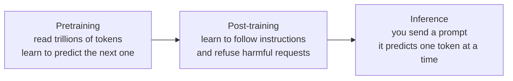

# What is a large language model?

## In one sentence

A **large language model** (LLM) is a program trained on huge amounts of text to do one thing: predict the next piece of text, over and over, until it has written a whole answer.

## Why it matters in 2027

Everything else in this playbook (agents, RAG, guardrails, evals) is built around an LLM. If you know what the model actually does, you can predict where it fails: it makes things up, it follows instructions it shouldn't, and it forgets anything outside what it was given. Most security and reliability problems come from forgetting one of those facts.

## Explain it like I'm new

Think of your phone keyboard's autocomplete, which suggests the next word. Now imagine an autocomplete that has read a large share of the public internet, many books and lots of code. It has become so good at guessing the next word that its guesses add up to essays, working programs and helpful explanations.

Where the analogy stops working: a modern LLM is also trained, after the reading phase, to follow instructions and hold a conversation. So it behaves more like an assistant than a keyboard.

## How it works

Three stages turn raw text into the assistant you chat with:

1. **Pretraining.** The model reads text and repeatedly guesses the next [token](../glossary.md#token) (a word or part of a word). Each wrong guess slightly adjusts billions of internal numbers called **parameters**. After enough text, those numbers capture grammar, facts, coding patterns and styles of reasoning.
2. **Post-training.** People and automated systems show the model examples of good answers and rate its outputs. This teaches it to answer questions, follow a format, use tools and decline some requests.
3. **Inference.** When you send a prompt, the model calculates a probability for every possible next token, picks one, adds it to the text, and repeats. A setting called [temperature](../glossary.md#temperature) controls how adventurous the pick is. Low temperature means it nearly always picks the most likely token.

Four facts follow from this design:

- **It has no live memory.** Each request starts from scratch. Chat apps fake memory by resending the conversation every time.
- **It only sees its context window.** The model can only use what is in the current request plus what it absorbed during training. See [tokens and context windows](tokens-and-context-windows.md).
- **It can be confidently wrong.** It produces likely-sounding text, not checked facts. A wrong answer delivered fluently is called a [hallucination](../glossary.md#hallucination).
- **Instructions and data look the same to it.** Everything arrives as one stream of tokens. This is the root of [prompt injection](../04-llm-security/prompt-injection.md).

## Example

You send: `The capital of France is`

The model's top guesses for the next token might be ` Paris` (very likely), ` a` (less likely) and ` located` (less likely). It picks ` Paris`, appends it, and continues with `.` and then stops.

Now send: `The capital of the fictional country Zubrovia is`. There is no right answer, but the model will often still produce a confident-sounding city name. Nothing inside it checks whether the fact exists.

## Common mistakes

- **Treating the model as a database.** Facts it "knows" can be stale or invented. Give it the source text instead (that's [RAG](rag-in-one-page.md)).
- **Assuming it remembers you.** Memory is something your application builds, not something the model has. See [agent memory](../06-agent-memory/README.md).
- **Trusting confident output.** Fluency is not accuracy. Check important answers with [evaluations](../05-evaluation/README.md).
- **Thinking a bigger model fixes everything.** Larger models make fewer mistakes, but they still hallucinate and can still be manipulated.

## Check yourself

1. What single task is an LLM trained to do during pretraining?
2. Why does a chatbot seem to remember your earlier messages?
3. Why can an LLM be tricked by instructions hidden inside a document?

Answers

1. Predict the next token of text.
2. The app resends the whole conversation with every request. The model itself keeps nothing between requests.
3. The model receives instructions and data as one stream of tokens, so it can't reliably tell which text is a command from you and which is content to process.

## Go deeper

- [Intro to Large Language Models](https://www.youtube.com/watch?v=zjkBMFhNj_g) by Andrej Karpathy - The clearest one-hour overview of how LLMs are trained and used. *Beginner · Video · 60 min*
- [But what is a GPT?](https://www.youtube.com/watch?v=wjZofJX0v4M) by 3Blue1Brown - Visual explanation of what happens inside the model. *Beginner · Video · 27 min*
- [Large language models, explained with a minimum of math and jargon](https://www.understandingai.org/p/large-language-models-explained-with) by Timothy B. Lee and Sean Trott - Long-form article that builds intuition step by step. *Beginner · Article · 30 min*
