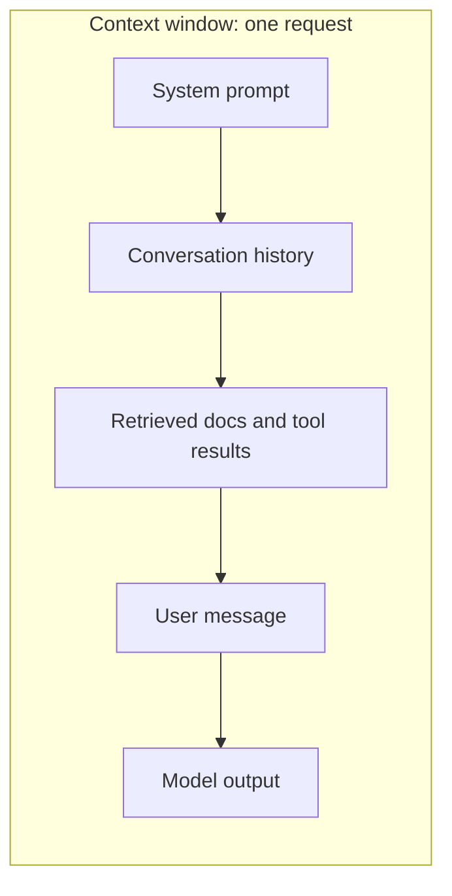

# Tokens and context windows

## In one sentence

A **token** is the small chunk of text an LLM reads and writes, and the **context window** is the maximum number of tokens the model can look at in a single request.

## Why it matters in 2027

You pay per token, latency grows with tokens, and anything that doesn't fit in the context window is invisible to the model. Coding agents, RAG systems and long-running agents all live or die by how well they manage this budget. Attackers know it too: flooding a model with tokens is a cheap way to run up your bill (see [unbounded consumption](../04-llm-security/unbounded-consumption.md)).

## Explain it like I'm new

Imagine a desk. Tokens are the index cards you can put on it, and the context window is the size of the desk. The model can only read cards that are on the desk right now. Your system prompt, the chat history, retrieved documents, tool results and the answer being written all compete for the same space. When the desk is full, something has to be taken off.

Where the analogy stops working: a real desk doesn't charge you per card. A context window does.

## How it works

**Tokenization.** Before the model sees your text, a tokenizer splits it into pieces from a fixed vocabulary. Common English words are often one token. Rare words, code and many non-English scripts split into several. A rough rule for English is about 4 characters, or three-quarters of a word, per token. Hindi, Tamil and other scripts often use more tokens for the same meaning, which makes them more expensive to process.

**The window.** Each model has a maximum context size, from tens of thousands to over a million tokens depending on the model. Everything in one request counts:



**Input and output tokens.** Providers usually price input tokens (what you send) and output tokens (what the model writes) separately, and output is typically several times more expensive. Many providers also offer **prompt caching**: if the start of your prompt is identical across requests, the repeated part is billed at a discount.

**Long isn't the same as good.** A bigger window lets you send more, but models often use information in the middle of a long context less reliably than information at the start or end. Sending fewer, more relevant tokens usually gives better answers. Choosing what goes into the window is called **context engineering**, and it's a core skill for [coding agents](../01-coding-agents/context-and-memory-files.md).

## Example

Count tokens yourself with OpenAI's open-source tokenizer library:

```python
# uv run --with tiktoken python count.py
import tiktoken

enc = tiktoken.get_encoding("o200k_base")
for text in ["Hello world", "unbelievably", "नमस्ते दुनिया", "def add(a, b): return a + b"]:
    print(len(enc.encode(text)), repr(text))
```

Each provider uses its own tokenizer, so counts differ a little between OpenAI, Anthropic and Google models. The pattern holds, though: plain English is cheap, while code and non-Latin scripts cost more per character.

## Common mistakes

- **Pasting whole files "just in case".** It costs more, slows responses and can make answers worse. Send what the task needs.
- **Forgetting history grows.** A chat that resends every message gets more expensive with every turn. Summarize or trim old turns.
- **Ignoring output limits.** Models also cap how many tokens they will write in one response. Long answers can be cut off mid-sentence.
- **Assuming word count equals token count.** Measure with the provider's tokenizer or the token counts returned in API responses.

## Check yourself

1. Roughly how many tokens is 1,000 words of English?
2. Name four things that compete for space in the context window.
3. Why might sending a 500-page document to a model with a 1-million-token window still give a poor answer?

<details>
<summary>Answers</summary>

1. About 1,300 tokens (around three-quarters of a word per token).
2. Any four of: system prompt, conversation history, retrieved documents, tool results, the user message, and the model's own output.
3. Models use information buried in the middle of very long contexts less reliably, and irrelevant text distracts them. Retrieving the few relevant pages usually works better and costs far less.

</details>

## Go deeper

- [OpenAI Tokenizer](https://platform.openai.com/tokenizer) - Paste text and see how it splits into tokens. *Beginner · Interactive tool · 5 min*
- [Let's build the GPT Tokenizer](https://www.youtube.com/watch?v=zduSFxRajkE) by Andrej Karpathy - Why tokenization causes many strange LLM behaviors. *Intermediate · Video · 2 h*
- [Lost in the Middle: How Language Models Use Long Contexts](https://arxiv.org/abs/2307.03172) - The research behind "long isn't the same as good". *Intermediate · Paper · 30 min*
- [Effective context engineering for AI agents](https://www.anthropic.com/engineering/effective-context-engineering-for-ai-agents) by Anthropic - How agent builders decide what goes into the window. *Intermediate · Article · 15 min*
