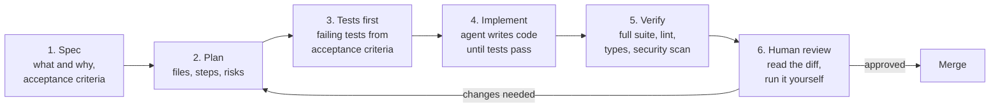

# The new development workflow with agents

## In one sentence

The **agentic SDLC** (software development life cycle) is a way of working where you spend your time on specs, plans, tests and review, and the coding agent does most of the typing, in this loop: spec, plan, implement, verify, review.

## Why it matters in 2027

When writing code gets cheap, the expensive parts are deciding what to build, making sure it's correct, and keeping it secure and maintainable. Teams that only "ask the agent and merge" ship bugs faster. Teams that give agents a clear spec, a test suite and a review step ship faster *and* safer. That freed-up time is exactly what you should spend on the topics in the second half of this playbook: safety, security and system design.

## Explain it like I'm new

Building a house with a fast, tireless but literal-minded crew. If you hand them a napkin sketch, you get something house-shaped and wrong. If you hand them drawings (spec), agree the order of work (plan), inspect each stage (tests) and do a final walkthrough (review), you get the house you wanted, much faster than building it yourself.

Where the analogy stops working: rebuilding a wall in code costs minutes, not weeks. So you can afford to throw away a bad attempt and try again with a better spec.

## How it works



1. **Spec.** A short document: the problem, who it's for, what "done" means as checkable acceptance criteria, and what's out of scope. Writing this forces you to think. Many tools now have a spec mode built in.
2. **Plan.** Ask the agent to propose a plan *without editing anything*: which files change, in what order, and what could go wrong. Fix the plan before any code exists. This is the cheapest place to catch mistakes.
3. **Tests first.** Turn acceptance criteria into failing tests. Now the agent has an objective target, and you have proof it works.
4. **Implement.** Let the agent work in small steps, running tests as it goes. One feature per session keeps context focused.
5. **Verify.** Full test suite, linter, type checker, and a security scan for secrets and known-vulnerable dependencies. Automate this in CI so it can't be skipped.
6. **Review.** Read the whole diff. Run the feature yourself. Ask a separate reviewer (a teammate or a read-only [subagent](subagents-and-hooks.md)) to look for security and edge cases.

**Where vibe coding fits.** "Vibe coding" (a term coined by Andrej Karpathy in early 2025) means prompting freely and accepting what the agent produces without close review. It's fine for prototypes and throwaway scripts. For anything users depend on, use the full loop above. See [vibe coding failure modes](vibe-coding-failure-modes.md).

## Example

A spec for one small feature:

```markdown
# Spec: CSV export for expense report

## Problem
Finance exports reports by copy-pasting into Excel.

## Acceptance criteria
- [ ] `expenses export --format csv --month 2026-10` writes `expenses-2026-10.csv`
- [ ] Columns: date, category, amount, currency, note (in that order, with a header row)
- [ ] Amounts use a dot decimal separator and two decimal places
- [ ] Notes containing commas or quotes are escaped correctly
- [ ] Exits with code 2 and a clear message if the month has no data

## Out of scope
Excel (.xlsx) output; emailing the file.
```

Each criterion becomes a test. Project [P1](../projects/p1-agent-built-cli/README.md) walks through this whole loop.

## Common mistakes

- **Skipping the plan.** Most bad agent output traces back to a misunderstanding that a 2-minute plan review would have caught.
- **Letting the agent write tests and code together, unreviewed.** It can write tests that match its bugs. Review the tests first, then let it implement.
- **Giant pull requests.** Agents can produce thousands of lines quickly. Humans can't review that. Keep changes small.
- **No CI.** Local "it passed" claims from an agent aren't proof. Run checks on every push.

## Check yourself

1. What are the six steps of the agentic workflow?
2. Why review the plan before any code is written?
3. When is vibe coding acceptable?

<details>
<summary>Answers</summary>

1. Spec, plan, tests first, implement, verify, review.
2. It's the cheapest point to catch misunderstandings. Fixing a plan takes minutes; untangling wrong code takes much longer.
3. For prototypes, experiments and throwaway scripts where bugs don't affect anyone else.

</details>

## Go deeper

- [Claude Code best practices](https://code.claude.com/docs/en/best-practices) - The explore, plan, code, commit workflow in practice. *Beginner · Docs · 25 min*
- [Not all AI-assisted programming is vibe coding](https://simonwillison.net/2025/Mar/19/vibe-coding/) by Simon Willison - Where the term came from and why the distinction matters. *Beginner · Article · 10 min*
- [Kiro specs](https://kiro.dev/docs/specs/) - An example of spec-driven development built into a tool. *Beginner · Docs · 10 min*
