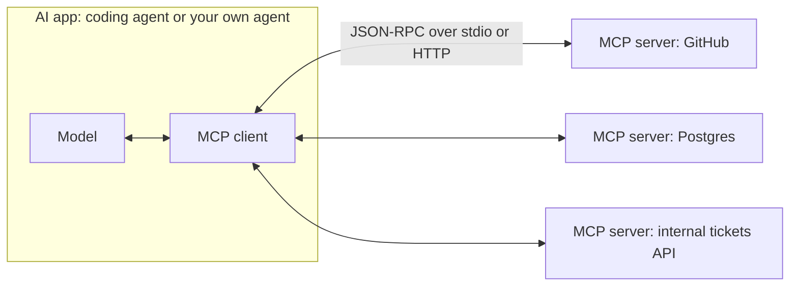

# MCP, the Model Context Protocol

## In one sentence

The **Model Context Protocol** (MCP) is an open standard that lets any AI application connect to outside tools and data (GitHub, databases, browsers, internal APIs) through small programs called MCP servers.

## Why it matters in 2027

Before MCP, every agent needed its own custom integration for every tool. Now one MCP server, say for your company's ticketing system, works in Claude Code, Codex, Cursor, Kiro, Antigravity and your own LangGraph agents. That makes MCP the main way agents reach real systems, which also makes it a major security boundary: an MCP server can read data and take actions with whatever permissions you gave it.

## Explain it like I'm new

USB for AI. Before USB, every printer, mouse and camera had its own plug. USB defined one plug, so any device works with any computer. MCP defines one "plug" between AI apps and tools. Build the server once, and every MCP-compatible agent can use it.

Where the analogy stops working: a USB mouse can't trick your computer into running commands. An MCP server's tool descriptions are text the model reads, so a malicious server can try to steer the model.

## How it works



- The **host** is the AI application. It contains an **MCP client** for each server it connects to.
- A **server** exposes three kinds of things:
  - **Tools**: actions the model can call, like `create_issue` or `run_query`. Each has a name, a description and an input schema.
  - **Resources**: data the app can read, like files or records.
  - **Prompts**: reusable prompt templates.
- **Transport.** Local servers usually run as a subprocess talking over standard input/output (stdio). Remote servers use HTTP, with OAuth for login.

When the model wants a tool, the host sends the call to the right server, gets the result, and puts it back into the model's context. It's the same [tool calling](../02-building-agents/tool-calling.md) idea, with a standard plug.

MCP was created by Anthropic in late 2024. It is now governed by the Agentic AI Foundation, a Linux Foundation project, and is supported by most major AI vendors.

## Example

Adding a server to a coding agent usually means one config entry. A typical JSON format:

```json
{
  "mcpServers": {
    "github": {
      "command": "docker",
      "args": ["run", "-i", "--rm", "-e", "GITHUB_PERSONAL_ACCESS_TOKEN", "ghcr.io/github/github-mcp-server"],
      "env": { "GITHUB_PERSONAL_ACCESS_TOKEN": "${GITHUB_TOKEN}" }
    }
  }
}
```

Now you can ask the agent "list the open issues labeled `bug` and draft a fix plan for the oldest one", and it will call the server's tools.

A minimal server in Python, using the official SDK:

```python
# uv run --with "mcp[cli]" python server.py
from mcp.server.fastmcp import FastMCP

mcp = FastMCP("leave-policy")

@mcp.tool()
def leave_balance(employee_id: str) -> int:
    """Return the remaining paid-leave days for an employee."""
    return {"E100": 12, "E101": 3}.get(employee_id, 0)

if __name__ == "__main__":
    mcp.run()
```

## Common mistakes

- **Installing servers from unknown sources.** A server runs code on your machine and feeds text to your model. Use official or well-reviewed servers, pin versions, and read what they do (see [supply chain](../04-llm-security/supply-chain.md)).
- **Over-scoped tokens.** Give the server a token that can only do what's needed: read-only, one repo, short expiry.
- **Too many servers at once.** Every tool description uses context and gives the model more ways to go wrong. Enable what the task needs.
- **Trusting tool output.** Results from a web page or issue tracker can contain injected instructions (see [prompt injection](../04-llm-security/prompt-injection.md)).

## Check yourself

1. What problem does MCP solve?
2. What are the three things an MCP server can expose?
3. Why is a tool's description a security concern?

<details>
<summary>Answers</summary>

1. It replaces custom one-off integrations with one standard, so a tool built once works with any MCP-compatible AI app.
2. Tools, resources and prompts.
3. The model reads the description as text and may follow instructions hidden in it, so a malicious server can steer the agent.

</details>

## Go deeper

- [What is the Model Context Protocol?](https://modelcontextprotocol.io/docs/getting-started/intro) - Official introduction with diagrams. *Beginner · Docs · 10 min*
- [MCP specification](https://modelcontextprotocol.io/specification/2025-11-25) - The full protocol, including authorization. *Intermediate · Spec · 1 h*
- [Connect Claude Code to tools via MCP](https://code.claude.com/docs/en/mcp) - Adding, scoping and securing servers in a coding agent. *Beginner · Docs · 15 min*
