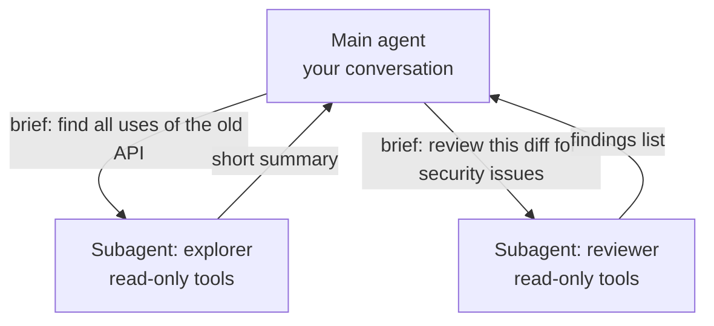

# Subagents and hooks

## In one sentence

A **subagent** is a helper agent that the main agent hands a focused job to, with its own fresh context and limited tools, while a **hook** is a script that runs automatically at a fixed point (before a tool runs, after a file is saved, when the agent stops) to check or enforce something.

## Why it matters in 2027

Subagents keep the main session's context clean and let work run in parallel. Hooks are how you turn "please always do X" into "X always happens". Together they're how experienced engineers make agents both faster and safer, and they're the bridge between using coding agents and [building agents](../02-building-agents/README.md) yourself.

## Explain it like I'm new

The main agent is a project lead. Subagents are specialists the lead sends off with a clear brief: "go read the whole payments folder and come back with a one-page summary". The specialist does the messy reading. The lead only gets the summary, so their desk stays clear.

Hooks are the building's safety systems. A smoke detector doesn't ask the project lead's opinion. It just goes off. A pre-tool hook that blocks `rm -rf` works the same way: it runs every time, whatever the model "decides".

## How it works

**Subagents**



- Each subagent starts with an empty context plus its brief, so it isn't distracted by your earlier conversation.
- You can give each one a specific system prompt, a smaller tool list (read-only is common) and sometimes a cheaper model.
- Only the result comes back, which saves the main agent's context.
- They're often defined as markdown files with front matter (name, description, tools), similar to [skills](skills.md).

**Hooks**

Hooks attach to lifecycle events. Names differ by tool, but the common ones are:

| Event | Typical use |
|---|---|
| Before a tool runs | Block dangerous commands, require approval for writes outside the project |
| After a tool runs | Run the formatter after every file edit; log actions |
| Session start | Load fresh context such as today's open tickets |
| Agent stops | Run tests; refuse to stop if they fail |

A hook is usually a shell command that gets JSON about the event on standard input. Its exit code says "allow" or "block".

> [!TIP]
> Rule of thumb: if breaking a rule would be a nuisance, put it in a [memory file](context-and-memory-files.md). If breaking it would be an incident, enforce it with a hook, permissions or CI.

## Example

A pre-tool hook script that blocks commands touching production config or force-pushing:

```bash
#!/usr/bin/env bash
# Receives the tool call as JSON on stdin. Exit 2 = block (Claude Code convention).
cmd=$(jq -r '.tool_input.command // empty')
if echo "$cmd" | grep -Eq 'git push.*(--force|-f)|prod\.env|DROP TABLE'; then
  echo "Blocked by policy: $cmd" >&2
  exit 2
fi
exit 0
```

And a subagent brief that works well:

```text
Use a read-only subagent to find every place we call `legacy_pay()` and list file, line,
and what each caller passes. Don't propose changes yet.
```

## Common mistakes

- **Using subagents for tiny tasks.** Each one costs a fresh context and adds delay. Use them for wide reading, parallel work, or independent review.
- **Vague briefs.** The subagent doesn't see your conversation. Include everything it needs.
- **Giving subagents write access by default.** Most helper work is reading. Keep them read-only unless they must edit.
- **Hooks that are slow or flaky.** A hook runs on every matching event. Keep it fast and deterministic.
- **Treating hooks as the only defense.** Pattern-matching commands can be bypassed. Combine hooks with sandboxes and least-privilege credentials.

## Check yourself

1. Why does a subagent help keep the main agent's context clean?
2. What makes a hook more reliable than an instruction in `AGENTS.md`?
3. Name a task that's a good fit for a subagent.

<details>
<summary>Answers</summary>

1. It does the reading and reasoning in its own context and only returns a short result.
2. It's code that runs every time the event fires, regardless of what the model decides.
3. Searching a large codebase, reviewing a diff independently, or researching documentation in parallel with other work.

</details>

## Go deeper

- [Subagents in Claude Code](https://code.claude.com/docs/en/sub-agents) - Defining helpers with their own tools and prompts. *Intermediate · Docs · 15 min*
- [Hooks reference](https://code.claude.com/docs/en/hooks) - Every hook event, its input and how blocking works. *Intermediate · Docs · 20 min*
- [Codex documentation](https://developers.openai.com/codex) by OpenAI - Sandboxing and approval modes in another agent. *Beginner · Docs · 15 min*
