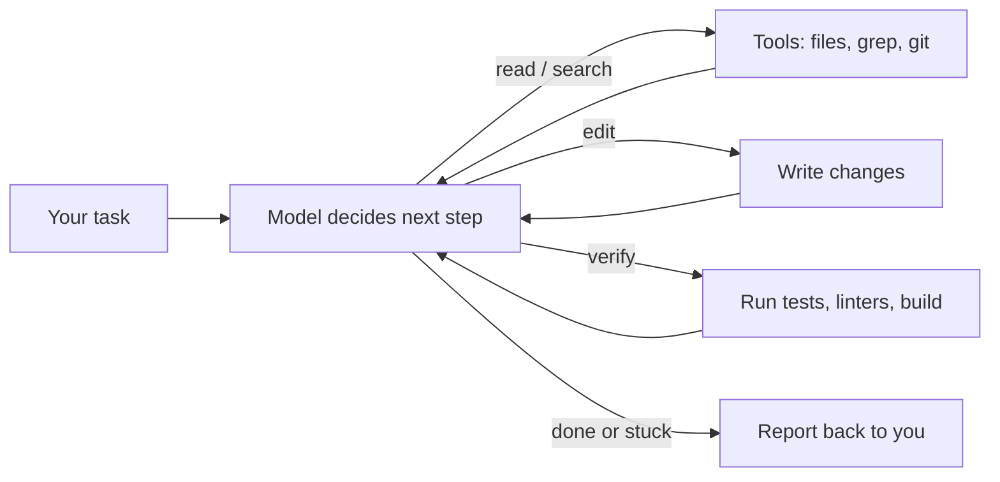

# What is a coding agent?

## In one sentence

A **coding agent** is an LLM that can act on your project, not just talk about it: it reads files, runs commands, edits code and checks its own work in a loop until the task is done or it needs you.

## Why it matters in 2027

Most software teams now expect engineers to work with a coding agent the way they expect you to use Git. The skill employers look for isn't "can prompt", it's "can direct an agent to produce correct, tested, reviewable code, and can tell when it's wrong". You still need to know how to code. Without that, you can't judge what the agent wrote, and you can't fix it when it goes off track.

## Explain it like I'm new

A chatbot is a consultant on the phone: you describe the problem, it suggests code, you copy and paste. A coding agent is a contractor you let into the workshop. It can open drawers (read files), use the tools (run tests, Git, the terminal) and build things (edit files). That's far more useful and far riskier, so you decide which tools it may use without asking.

Where the analogy stops working: a contractor remembers yesterday's job. An agent starts every session with an empty head unless you give it [memory files](context-and-memory-files.md).

## How it works

Underneath, every coding agent runs the same [agent loop](../02-building-agents/the-agent-loop.md):



The parts that differ between products:

- **Where it runs.** In the terminal (Claude Code, OpenAI Codex CLI, Antigravity CLI), in an editor or IDE (Cursor, Kiro, GitHub Copilot, Google Antigravity), or in the cloud working on a branch while you do something else.
- **Permissions.** Whether it must ask before editing files or running commands, and whether commands run in a **sandbox** (an isolated environment with limited file and network access).
- **Context features.** [Memory files](context-and-memory-files.md) such as `AGENTS.md`, on-demand [skills](skills.md), connections to outside tools through [MCP](mcp.md), and helpers like [subagents and hooks](subagents-and-hooks.md).

These features work in similar ways across products, so what you learn in one carries over to the others. See the [tool comparison](tool-comparison.md) for current options and prices.

> [!IMPORTANT]
> An agent with terminal access can do anything you can do in that terminal, including deleting files, pushing to Git or reading secrets. Start with the default "ask before acting" permissions and loosen them one tool at a time.

## Example

A realistic first task in an unfamiliar repo:

```text
Read the README and the tests folder. Then explain, in 10 bullet points, how this project is structured
and how to run its tests. Don't change any files.
```

Then a small, checkable change:

```text
Add a --json flag to the `report` command that prints the same data as JSON.
Write a failing test first, then make it pass. Run the full test suite before you finish.
Show me the diff and stop. Don't commit.
```

Both prompts give the agent a way to verify its work (tests) and a clear stopping point.

## Common mistakes

- **Giving vague tasks.** "Improve the code" produces sweeping, unreviewable changes. Ask for one focused change with a test.
- **No way to verify.** If there are no tests, the agent can't check itself, and neither can you. Ask it to write tests first.
- **Accepting diffs you don't understand.** If you can't explain the change, don't merge it. Ask the agent to explain, or simplify.
- **Letting the session run too long.** Context fills up and quality drops. Start fresh sessions for new tasks.
- **Turning off all permission prompts on day one.** Earn trust gradually and use sandboxes.

## Check yourself

1. What can a coding agent do that a chatbot can't?
2. Why do you still need to know how to code?
3. What gives an agent a way to check its own work?

<details>
<summary>Answers</summary>

1. Act on your project directly: read and edit files, run commands and tests, and loop until the task is done.
2. To judge whether its code is correct, safe and maintainable, and to steer or fix it when it goes wrong.
3. Automated checks it can run, mainly tests, plus linters, type checkers and builds.

</details>

## Go deeper

- [Building effective agents](https://www.anthropic.com/engineering/building-effective-agents) by Anthropic - What makes something an agent, and when it's worth it. *Beginner · Article · 20 min*
- [Claude Code best practices](https://code.claude.com/docs/en/best-practices) - Practical habits that transfer to any coding agent. *Beginner · Docs · 25 min*
- [OpenAI Codex documentation](https://developers.openai.com/codex) - Overview of the CLI, IDE and cloud versions. *Beginner · Docs · 15 min*
