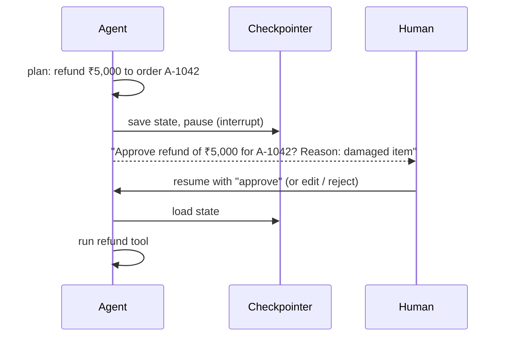

# Human-in-the-loop

## In one sentence

**Human-in-the-loop** (HITL) means the agent pauses before a risky or irreversible action, shows a person exactly what it's about to do, and only continues after that person approves, edits or rejects it.

## Why it matters in 2027

It's the single most effective control against agents doing damage, whether through a bug, a hallucination or an attack. Both OWASP agent lists recommend approval steps for high-impact actions. But approvals only work if people actually read them, so designing *good* approval requests is part of the job. OWASP lists "human-agent trust exploitation", where a person approves something harmful because the agent sounded confident, as one of its top ten agentic risks ([ASI09](../04-llm-security/agentic-threats.md)).

## Explain it like I'm new

A bank's "confirm this transfer" screen. The app has done everything up to the final step, then shows you: "Send ₹40,000 to R. Sharma, account ending 4471?" You check, then tap confirm. The app could have sent it automatically, but the design forces a pause exactly where a mistake would hurt.

Where the analogy stops working: if every tap needs confirming, people stop reading and tap "yes" by reflex. Ask only when it matters.

## How it works



**Decide what needs approval.** A useful rule: approve anything that is irreversible, costs money, sends something outside the organization, changes permissions, or touches production. Reading and drafting usually don't need approval.

**Make the request easy to judge.** Show the exact action and arguments, a plain-language summary of the effect, the reason, and the risk. "Run tool? [y/n]" is not enough.

**Make pausing durable.** Approvals can take hours. The agent's state must be saved so it can resume later, even after a restart. In [LangGraph](langgraph-basics.md), calling `interrupt()` inside a node saves state through the checkpointer and returns control to your app. Your app later resumes with `Command(resume=...)`.

**Log every decision**: who approved what and when. You'll need it for audits and incident reviews.

## Example

An approval gate in LangGraph. It runs offline:

```python
# test: run
from typing import TypedDict

from langgraph.checkpoint.memory import InMemorySaver
from langgraph.graph import END, START, StateGraph
from langgraph.types import Command, interrupt


class State(TypedDict):
    order_id: str
    amount: int
    status: str


def approve(state: State) -> dict:
    decision = interrupt({
        "action": "refund",
        "order_id": state["order_id"],
        "amount_inr": state["amount"],
        "summary": f"Refund ₹{state['amount']:,} to the card used for {state['order_id']}. This can't be undone.",
    })
    return {"status": "approved" if decision == "approve" else "rejected"}


def refund(state: State) -> dict:
    return {"status": "refunded"} if state["status"] == "approved" else {}


builder = StateGraph(State)
builder.add_node("approve", approve)
builder.add_node("refund", refund)
builder.add_edge(START, "approve")
builder.add_edge("approve", "refund")
builder.add_edge("refund", END)
graph = builder.compile(checkpointer=InMemorySaver())

config = {"configurable": {"thread_id": "refund-A-1042"}}
paused = graph.invoke({"order_id": "A-1042", "amount": 5000, "status": ""}, config)
print("Waiting for human:", paused["__interrupt__"][0].value["summary"])

print(graph.invoke(Command(resume="approve"), config))  # later, after a person clicks Approve
```

Project [P3](../projects/p3-langgraph-research-agent/README.md) uses this pattern before the agent saves anything.

## Common mistakes

- **Approving everything.** Approval fatigue makes people click "yes" without reading. Gate only high-impact actions.
- **Vague requests.** Show exact arguments and effects, not "the agent wants to use a tool".
- **Letting the model decide whether to ask.** The rule for what needs approval must live in code, not in the prompt.
- **Non-durable pauses.** If state is held only in memory, a restart loses the request or, worse, repeats the action.
- **Side effects before the interrupt.** When a node resumes, LangGraph re-runs it from the start. Put actions with side effects after the approval, in a separate node.

## Check yourself

1. Name four kinds of action that should usually need human approval.
2. What makes an approval request easy to judge?
3. Why should the decision about which actions need approval live in code?

<details>
<summary>Answers</summary>

1. Any four of: irreversible actions, spending money, sending data or messages outside the organization, changing permissions, and changing production systems.
2. The exact action and arguments, a plain summary of the effect, the reason, and the risk.
3. A prompt can be ignored, misunderstood or overridden by injected text. Code always applies the rule.

</details>

## Go deeper

- [Interrupts in LangGraph](https://docs.langchain.com/oss/python/langgraph/interrupts) - Pausing, resuming and editing state. *Intermediate · Docs · 20 min*
- [Human-in-the-loop middleware](https://docs.langchain.com/oss/python/langchain/human-in-the-loop) by LangChain - Approval policies for tool calls in prebuilt agents. *Intermediate · Docs · 15 min*
- [OWASP Top 10 for Agentic Applications 2026](https://genai.owasp.org/resource/owasp-top-10-for-agentic-applications-for-2026/) - See ASI09 on human-agent trust. *Intermediate · Standard · 30 min*
