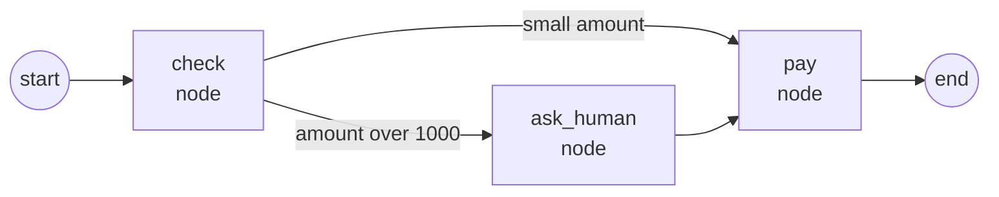

# LangGraph basics

## In one sentence

**LangGraph** is an open-source Python and JavaScript framework that models an agent as a graph: **nodes** are steps (functions), **edges** decide which step runs next, a shared **state** is passed between them, and a **checkpointer** saves that state after every step.

## Why it matters in 2027

LangGraph is one of the most widely used frameworks for production agents because it makes the loop explicit. You can see and test each step, pause for a human, resume after a crash, and run several agents together. It works with any model provider. The ideas (state, nodes, edges, checkpoints) transfer to other frameworks too.

## Explain it like I'm new

A board game. The board shows the spaces (nodes) and the arrows between them (edges). Some spaces have a fork where a dice roll or a card decides which way you go (conditional edges). Your game piece carries a scorecard (state) that every space can read and update. And you can take a photo of the board after every move (checkpoint), so if someone knocks the table, you set it back up exactly as it was.

## How it works



- **State** is a typed dictionary (a `TypedDict` or Pydantic model). Each node receives the current state and returns only the keys it wants to update.
- **Nodes** are plain Python functions. A node might call an LLM, call a tool, or just run code.
- **Edges** connect nodes. A **conditional edge** runs a small function that looks at the state and returns the name of the next node. This is where the agent "decides".
- **Checkpointer.** When you compile the graph with a checkpointer, LangGraph saves state after each step under a `thread_id`. That enables memory within a conversation, resuming after failures, and pausing for a human ([human-in-the-loop](human-in-the-loop.md)). Use `InMemorySaver` for learning and a database-backed saver (SQLite, Postgres) in production.

For the common "LLM with tools in a loop" pattern, LangGraph and LangChain also provide ready-made agent builders. Learn the graph basics first so you understand what those builders do for you.

## Example

A refund workflow with no LLM at all, so it runs offline. Real agents put an LLM call inside a node; the graph mechanics are identical.

```python
# test: run
from typing import TypedDict

from langgraph.checkpoint.memory import InMemorySaver
from langgraph.graph import END, START, StateGraph


class State(TypedDict):
    amount: int
    status: str


def check(state: State) -> dict:
    return {"status": "needs_review" if state["amount"] > 1000 else "approved"}


def route(state: State) -> str:
    return "review" if state["status"] == "needs_review" else "pay"


def review(state: State) -> dict:
    return {"status": "approved"}  # a human or a stricter check would go here


def pay(state: State) -> dict:
    return {"status": "paid"}


builder = StateGraph(State)
builder.add_node("check", check)
builder.add_node("review", review)
builder.add_node("pay", pay)
builder.add_edge(START, "check")
builder.add_conditional_edges("check", route, ["review", "pay"])
builder.add_edge("review", "pay")
builder.add_edge("pay", END)
graph = builder.compile(checkpointer=InMemorySaver())

print(graph.invoke({"amount": 50, "status": ""}, {"configurable": {"thread_id": "a"}}))
print(graph.invoke({"amount": 5000, "status": ""}, {"configurable": {"thread_id": "b"}}))
```

Run it with `uv run --with langgraph python refund.py`. Then try `graph.get_state({"configurable": {"thread_id": "b"}})` to see the saved checkpoint.

## Common mistakes

- **Starting with a giant graph.** Build two or three nodes, test them, then grow.
- **Putting everything in state.** State is saved at every step. Keep it to what later steps need.
- **Forgetting the `thread_id`.** Without it, there's nothing to resume and no conversation memory.
- **Using `InMemorySaver` in production.** It's lost when the process restarts. Use a persistent checkpointer.
- **Hiding decisions inside prompts.** If a rule must always hold ("refunds over 1,000 need review"), make it a conditional edge in code, as in the example.

## Check yourself

1. What do nodes, edges and state each represent?
2. What does a checkpointer make possible?
3. In the example, why is the "over 1000" rule a conditional edge instead of an instruction to an LLM?

<details>
<summary>Answers</summary>

1. Nodes are steps (functions), edges decide which step runs next, and state is the shared data passed between steps.
2. Saving state after every step, so you can keep conversation memory, resume after a crash, inspect history, and pause for human input.
3. Code always enforces it. An LLM could be talked out of it or simply make a mistake.

</details>

## Go deeper

- [LangGraph overview](https://docs.langchain.com/oss/python/langgraph/overview) - Official introduction and install. *Beginner · Docs · 10 min*
- [Thinking in LangGraph](https://docs.langchain.com/oss/python/langgraph/thinking-in-langgraph) - How to break a problem into nodes and state. *Beginner · Docs · 20 min*
- [LangChain Academy: Introduction to LangGraph](https://academy.langchain.com/courses/intro-to-langgraph) - Free official course with notebooks. *Beginner · Course · 6 h*
