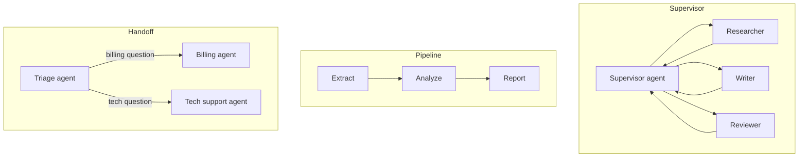

# Multi-agent patterns

## In one sentence

A **multi-agent system** splits work between several specialized agents, each with its own instructions, tools and context, coordinated by a supervisor, a fixed pipeline, or handoffs from one agent to another.

## Why it matters in 2027

Multi-agent designs help when a task needs very different skills or tools, or when parts can run in parallel. They also multiply cost, latency and failure points, and they add new security risks: agents trusting each other's messages, one fault cascading across the system, and privilege leaking from one agent to another. Knowing when to use them, and when not to, is a common system-design interview topic.

## Explain it like I'm new

A newsroom. An editor (supervisor) receives a story idea, sends a researcher to gather facts, a writer to draft, and a fact-checker to verify. Each person has their own desk and expertise. The editor stitches it together. This beats one person doing everything only when the story is big enough to need it. For a two-line news brief, the hand-offs cost more than they save.

## How it works

Three common patterns:

| Pattern | How it works | Good for | Watch out for |
|---|---|---|---|
| **Supervisor** | One agent plans and delegates to workers, then combines results | Open-ended research, tasks with varied sub-steps | Supervisor becomes a bottleneck; cost grows with each round |
| **Pipeline** | Fixed order of steps, each possibly an LLM call | Predictable processes (extract, then summarize, then format) | Not really "agents"; that's often a good thing |
| **Handoff** | An agent transfers the conversation to a specialist | Customer support routing | Context lost at handoff; specialist trusting the handoff blindly |

In [LangGraph](langgraph-basics.md), each agent can be a node (or a whole subgraph), and the supervisor's choice is a conditional edge. The [Agent2Agent (A2A) protocol](https://a2a-protocol.org/) is an open standard for agents built by different teams or vendors to talk to each other over a network.

**Security rules for multi-agent systems:**

- **Each agent gets its own identity and least-privilege tools.** The researcher doesn't need the payment tool.
- **Treat messages from other agents as untrusted input**, just like user input. A compromised or confused agent can pass on injected instructions.
- **Re-check permissions at every privileged step.** Don't let a low-privilege agent ask a high-privilege one to act on its behalf without checking the original user's rights. This is the classic "confused deputy" problem.
- **Add circuit breakers.** If one agent fails or loops, stop the chain instead of letting errors spread (OWASP calls this cascading failure).

## Example

A research task in [P3](../projects/p3-langgraph-research-agent/README.md) uses a small supervisor pattern:

1. **Planner** turns the question into 2 to 4 sub-questions.
2. **Researcher** answers each sub-question using a search tool (read-only).
3. **Writer** drafts the final answer with citations.
4. A human approves before the result is saved to long-term memory.

Only the researcher can call search. Only the save step can write, and only after approval.

## Common mistakes

- **Using multiple agents because it sounds advanced.** Start with one agent and good tools. Split only when you can show it helps.
- **Sharing one all-powerful credential across agents.** One compromised agent then compromises everything.
- **Passing whole conversation histories between agents.** Pass a short, structured brief instead. It's cheaper and leaks less.
- **No end-to-end tracing.** When five agents are involved, you can't debug without seeing every step (see [observability](../07-agent-ops-production/observability-and-tracing.md)).

## Check yourself

1. Name the three multi-agent patterns in this note and one good use for each.
2. What is a confused deputy in a multi-agent system?
3. Why treat messages from another agent as untrusted?

Answers

1. Supervisor (open-ended research), pipeline (predictable multi-step processing), handoff (routing support conversations to specialists).
2. A low-privilege agent passes a request to a high-privilege agent, which carries it out without checking whether the original user was allowed to.
3. The other agent may have been manipulated by injected content, may be malfunctioning, or may be impersonated.

## Go deeper

- [Multi-agent systems in LangChain](https://docs.langchain.com/oss/python/langchain/multi-agent) - The main patterns, with code. *Intermediate · Docs · 20 min*
- [How we built our multi-agent research system](https://www.anthropic.com/engineering/multi-agent-research-system) by Anthropic - Real lessons, including the cost trade-offs. *Intermediate · Article · 25 min*
- [OWASP Multi-Agentic System Threat Modelling Guide](https://genai.owasp.org/resource/multi-agentic-system-threat-modeling-guide-v1-0/) - Threats specific to agents working together. *Intermediate · Guide · 45 min*
