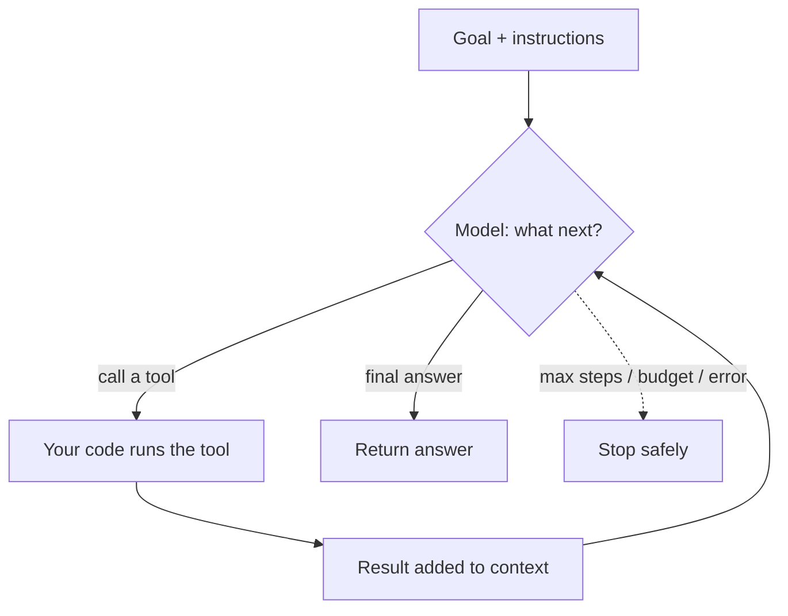

# The agent loop

## In one sentence

An **agent** is an LLM running in a loop: it looks at the goal and what has happened so far, decides on the next action (usually calling a tool), sees the result, and repeats until it can give a final answer or hits a limit.

## Why it matters in 2027

Agents are how LLM apps move from answering to doing: booking, refunding, deploying, researching. They're also where the biggest failures happen, because a loop that can act can act wrongly many times in a row. OWASP moved "excessive agency" up to third place in its 2026 list of LLM risks for that reason ([OWASP LLM Top 10 2026](https://genai.owasp.org/resource/owasp-genai-llm-top-10-2026/)). Understanding the loop is how you put limits in the right places.

## Explain it like I'm new

A detective solving a case. They don't know the answer at the start. They look at the clues (state), decide what to check next (reason), go and check it (act), and note what they found (observe). They repeat until they can name the culprit, or until the chief says "time's up".

Where the analogy stops working: a detective knows when a clue is a plant. An LLM agent often doesn't (see [prompt injection](../04-llm-security/prompt-injection.md)).

## How it works



Each pass through the loop is one model call:

1. **Context.** Your code sends the system prompt, the goal, the list of available [tools](tool-calling.md), and everything that's happened so far.
2. **Decide.** The model replies with either a tool call (`search_orders(customer="C42")`) or a final answer.
3. **Act.** Your code, not the model, runs the tool. This is where you check permissions.
4. **Observe.** The tool's result goes back into the context, and the loop repeats.

Production agents add a few essentials around the loop:

- **Stop conditions**: a maximum number of steps, a token or cost budget, and a timeout.
- **State**: what to remember within this task (the messages so far) and across tasks ([memory](../06-agent-memory/README.md)).
- **Guards**: which tools need human approval ([human-in-the-loop](human-in-the-loop.md)) and which inputs are untrusted.

This pattern is often called **ReAct** (reason + act), after a 2022 paper. Frameworks like [LangGraph](langgraph-basics.md) give you the loop, state and stop conditions ready-made.

## Example

A complete agent loop in plain Python with a scripted fake model, so you can run it without an API key:

```python
# test: run
import json

TOOLS = {"get_weather": lambda city: {"Delhi": "34°C, haze", "Pune": "27°C, clear"}.get(city, "unknown")}

def fake_model(messages):
    """Stands in for an LLM: first asks for a tool, then answers using the result."""
    last = messages[-1]
    if last["role"] == "user":
        return {"tool": "get_weather", "args": {"city": "Pune"}}
    return {"answer": f"It's {last['content']} in Pune right now."}

def run_agent(goal, model=fake_model, max_steps=5):
    messages = [{"role": "user", "content": goal}]
    for _ in range(max_steps):
        decision = model(messages)
        if "answer" in decision:
            return decision["answer"]
        result = TOOLS[decision["tool"]](**decision["args"])  # your code runs the tool
        messages.append({"role": "tool", "content": result})
        print("tool call:", json.dumps(decision), "->", result)
    return "Stopped: step limit reached."

print(run_agent("What's the weather in Pune?"))
```

Swap `fake_model` for a real LLM call and you have a real agent. Everything else (tools, limits, state) stays the same.

## Common mistakes

- **No step limit.** A confused agent can loop forever and burn money. Always cap steps and cost.
- **Letting the model "run" tools.** The model only *asks*. Your code decides whether to run the call, with what permissions.
- **Too many tools.** Each extra tool is another way to go wrong. Start with two or three.
- **Using an agent where a fixed workflow would do.** If the steps are always the same, write them as code. See [when not to use an agent](when-not-to-use-agents.md).

## Check yourself

1. What are the four steps of each pass through the loop?
2. Who actually executes a tool call, the model or your code?
3. Name three stop conditions every production agent should have.

<details>
<summary>Answers</summary>

1. Send context, model decides, your code acts, the result is observed and added to the context.
2. Your code. The model only produces a request to call a tool.
3. A maximum number of steps, a token or cost budget, and a timeout. Errors should also stop the loop safely.

</details>

## Go deeper

- [Building effective agents](https://www.anthropic.com/engineering/building-effective-agents) by Anthropic - Workflows versus agents, with the common patterns. *Beginner · Article · 20 min*
- [ReAct: Synergizing Reasoning and Acting in Language Models](https://arxiv.org/abs/2210.03629) - The paper behind the reason-act-observe loop. *Intermediate · Paper · 30 min*
- [LangGraph overview](https://docs.langchain.com/oss/python/langgraph/overview) - How a framework packages the loop. *Beginner · Docs · 10 min*
