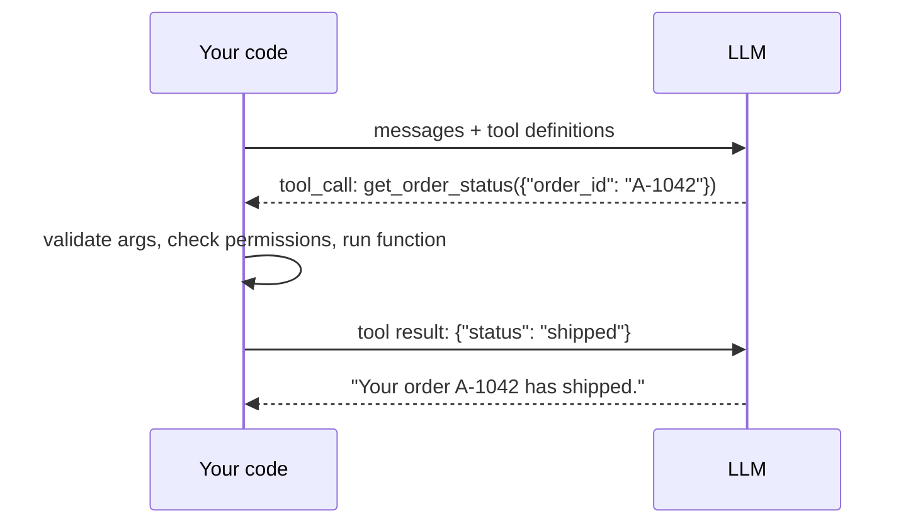

# Tool calling

## In one sentence

**Tool calling** (also called function calling) lets you describe functions to an LLM with a name, a description and a JSON schema for the arguments, so the model can reply with a structured request to call one, which your code then validates and runs.

## Why it matters in 2027

Tools are how agents touch the real world: databases, payments, email, shell commands. Every tool is also a permission. If the model can be tricked, it can be tricked into calling your tools with an attacker's arguments. Designing small, well-described, least-privilege tools is one of the most valuable skills in this playbook.

## Explain it like I'm new

A restaurant order slip. The waiter (model) can't cook, but can fill in a slip with fixed fields: dish, quantity, table, allergies. The kitchen (your code) reads the slip, checks it makes sense ("we don't serve 400 biryanis to one table") and cooks. The slip format is the schema.

Where the analogy stops working: a waiter won't write an order because a note on the table told them to. A model might.

## How it works



1. **Define tools.** For each, give a name, a clear description of when to use it, and a JSON Schema for its arguments.
2. **The model chooses.** If a tool fits, it returns a tool call (name plus JSON arguments) instead of text. It may call several.
3. **Your code validates and runs.** Check the arguments against the schema, check the user is allowed to do this, then run it.
4. **Return the result** as a `tool` message. The model continues, maybe calling more tools, until it answers.

**Designing good tools:**

- **Narrow beats general.** `get_order_status(order_id)` is safer than `run_sql(query)`.
- **Descriptions are prompts.** Say what the tool does, when to use it, and when not to.
- **Enforce permissions in the tool, not the prompt.** The tool should know who the user is and refuse what they can't do.
- **Return small, clean results.** Big raw outputs waste context and may carry injected text.

## Example

A tool definition and the code that runs it, using LiteLLM (the same format works for any provider):

```python
# uv run --with litellm python tools.py   (needs GEMINI_API_KEY)
import json
from litellm import completion

ORDERS = {"A-1042": {"owner": "u1", "status": "shipped"}}

def get_order_status(order_id: str, *, user_id: str) -> dict:
    order = ORDERS.get(order_id)
    if not order or order["owner"] != user_id:          # permission check lives in code
        return {"error": "order not found"}
    return {"status": order["status"]}

tools = [{
    "type": "function",
    "function": {
        "name": "get_order_status",
        "description": "Look up the shipping status of one of the current user's orders by order ID.",
        "parameters": {
            "type": "object",
            "properties": {"order_id": {"type": "string", "pattern": "^A-\\d{4}$"}},
            "required": ["order_id"],
        },
    },
}]

messages = [{"role": "user", "content": "Where is my order A-1042?"}]
resp = completion(model="gemini/gemini-3.5-flash-lite", messages=messages, tools=tools)
msg = resp.choices[0].message
messages.append(msg)
for call in msg.tool_calls or []:
    args = json.loads(call.function.arguments)
    result = get_order_status(args["order_id"], user_id="u1")  # user_id from your session, never the model
    messages.append({"role": "tool", "tool_call_id": call.id, "content": json.dumps(result)})
print(completion(model="gemini/gemini-3.5-flash-lite", messages=messages, tools=tools).choices[0].message.content)
```

Notice that `user_id` comes from your app's login session, not from the model. If the model could choose the user, a prompt like "check order A-1042 for user u2" would leak someone else's data.

## Common mistakes

- **Trusting model-supplied identity or permissions.** Who the user is comes from your auth system.
- **Skipping argument validation.** Models produce malformed or malicious arguments. Validate types, ranges and formats.
- **Generic power tools** (`run_shell`, `run_sql`, `http_request`). If you must have them, sandbox them and require approval.
- **Passing raw tool output back.** Trim it. Mark it as data. Strip anything you don't need.
- **Unclear descriptions.** If the model picks the wrong tool, fix the description first.

## Check yourself

1. What three things make up a tool definition?
2. Why must `user_id` never be a tool argument the model fills in?
3. Why is `get_invoice(invoice_id)` safer than `run_sql(query)`?

<details>
<summary>Answers</summary>

1. A name, a description, and a JSON Schema for the arguments.
2. The model can be manipulated by user text or injected content, so it could act as another user. Identity must come from your authenticated session.
3. It can only do one narrow thing, with an argument you can validate and a permission check built in. `run_sql` can read or change anything the database account can.

</details>

## Go deeper

- [Function calling](https://ai.google.dev/gemini-api/docs/function-calling) by Google - Tool calling with Gemini, with diagrams. *Beginner · Docs · 15 min*
- [Function calling guide](https://platform.openai.com/docs/guides/function-calling) by OpenAI - Schemas, parallel calls and strict mode. *Beginner · Docs · 15 min*
- [Writing effective tools for agents](https://www.anthropic.com/engineering/writing-tools-for-agents) by Anthropic - How to design tools models use well. *Intermediate · Article · 20 min*
