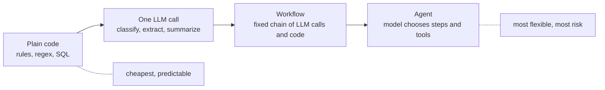

# When not to use an agent

## In one sentence

Use the simplest thing that works, in this order: plain code, a single LLM call, a fixed **workflow** of LLM calls, and only then an agent that chooses its own steps, because each step up adds cost, delay, unpredictability and risk.

## Why it matters in 2027

Many failed AI projects are agents that should have been a workflow, or workflows that should have been one prompt. Being able to say "this doesn't need an agent, and here's why" is a sign of seniority. It also shrinks your attack surface: a system that can't choose its own actions can't be tricked into choosing harmful ones.

## Explain it like I'm new

Getting from home to the office. If you take the same route every day, follow it (a script). If traffic varies, check a map once before you leave (one LLM call). If the trip has fixed legs (walk, train, walk), plan each leg (a workflow). You'd only hire a driver who decides everything as they go (an agent) for a trip you've never made, in a city you don't know.

## How it works

Ask these questions about your task:

| Question | If yes | If no |
|---|---|---|
| Can I write the rules down? | Plain code | Keep going |
| Is it one transformation of input to output? | One LLM call | Keep going |
| Are the steps always the same, in the same order? | Workflow | Keep going |
| Do the steps depend on what's discovered along the way? | Agent | Re-check the earlier questions |

**Workflow patterns** worth knowing, from simplest up:

- **Chain**: step 1's output feeds step 2 (outline, then draft, then edit).
- **Router**: one call classifies the input, then code sends it down the right path.
- **Parallel**: several calls run at once and code combines them (e.g. three reviewers vote).
- **Evaluator loop**: one call drafts, another checks against criteria, repeat up to N times.

All of these keep control flow in your code. You get much of the benefit of an agent with far more predictability.

## Example

**Task:** "Sort incoming support emails into billing, shipping or technical, and draft a reply."

- An agent could do it: read the email, decide what to look up, look it up, draft.
- But the steps are always the same. A **router workflow** is better: one call classifies (with a fixed list of categories), code fetches the customer's recent orders, a second call drafts the reply using a category-specific template, and a person reviews before sending.

This is cheaper, easier to test with [evals](../05-evaluation/README.md), and an injected instruction in an email can't make it call a refund tool, because no such tool is available.

**When an agent is right:** "Investigate why checkout latency doubled last night." The agent needs to look at dashboards, logs and recent deploys, and each finding decides the next step. A fixed workflow can't anticipate that.

## Common mistakes

- **Starting with a multi-agent framework** before trying one good prompt.
- **Letting an agent "decide" things that are really business rules.** Write rules in code.
- **Judging by demos.** Agents look impressive on happy paths. Evaluate on your messy real inputs, and count cost per task.
- **Never revisiting.** As models improve, a workflow might collapse into one call. Re-check periodically.

## Check yourself

1. List the four levels from simplest to most complex.
2. What question tells you a task needs an agent rather than a workflow?
3. Why is a router workflow safer than an agent for email triage?

Answers

1. Plain code, one LLM call, workflow, agent.
2. Whether the next steps depend on what's discovered along the way, so they can't be fixed in advance.
3. Control flow and available tools are fixed in code, so injected text in an email can't make the system take actions it wasn't built to take. It's also easier to test.

## Go deeper

- [Building effective agents](https://www.anthropic.com/engineering/building-effective-agents) by Anthropic - The source of the workflow-pattern names used here. *Beginner · Article · 20 min*
- [Workflows and agents](https://docs.langchain.com/oss/python/langgraph/workflows-agents) by LangChain - Each pattern implemented in LangGraph. *Intermediate · Docs · 25 min*
- [A practical guide to building agents](https://openai.com/business/guides-and-resources/a-practical-guide-to-building-ai-agents/) by OpenAI - When agents are worth it, and orchestration options. *Beginner · Guide · 30 min*
