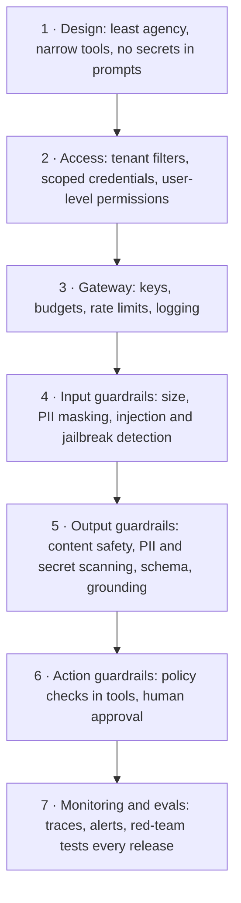

# 03 · AI safety and guardrails

The practical layer that sits around a model: checks on what goes in, what comes out, and what actions it takes. This module is the "defense" companion to [04 · LLM security](../04-llm-security/README.md), which covers the attacks. Read them in either order.

**You'll be able to:** explain and design input, output and action guardrails, handle personal data properly, choose between guardrail tools, and use a gateway to control cost and access.

| # | Note | Level | Time |
|---|---|---|---|
| 1 | [What are guardrails?](what-are-guardrails.md) | Beginner | 10 min |
| 2 | [Jailbreaks](jailbreaks.md) | Beginner | 10 min |
| 3 | [PII and privacy](pii-and-privacy.md) | Beginner | 12 min |
| 4 | [Guardrail frameworks compared](guardrail-frameworks.md) | Intermediate | 12 min |
| 5 | [LLM gateways](llm-gateways.md) | Intermediate | 12 min |

## Defense layers

No single control stops every attack. Each layer below reduces specific OWASP risks, and together they make a fooled model much less dangerous.

| Layer | Main OWASP 2026 risks reduced |
|---|---|
| 1 · Design | [LLM03 Excessive agency](../04-llm-security/excessive-agency.md), [LLM08 Hidden context exposure](../04-llm-security/hidden-context-exposure.md) |
| 2 · Access | [LLM02 Sensitive info disclosure](../04-llm-security/sensitive-information-disclosure.md), [LLM09 Vector weaknesses](../04-llm-security/vector-and-embedding-weaknesses.md) |
| 3 · Gateway | [LLM06 Unbounded consumption](../04-llm-security/unbounded-consumption.md) |
| 4 · Input guardrails | [LLM01 Prompt injection](../04-llm-security/prompt-injection.md), LLM02, LLM06 |
| 5 · Output guardrails | [LLM10 Improper output handling](../04-llm-security/improper-output-handling.md), [LLM07 Misinformation](../04-llm-security/misinformation.md), LLM02 |
| 6 · Action guardrails | LLM03, [ASI02 and ASI09](../04-llm-security/agentic-threats.md) |
| 7 · Monitoring and evals | All of them, by catching what the other layers miss |

Supply-chain and poisoning risks ([LLM04](../04-llm-security/supply-chain.md), [LLM05](../04-llm-security/data-and-model-poisoning.md)) are handled mostly outside the request path: in your build pipeline, dependency choices and data-ingestion process.

**Project:** [P4 · Guardrailed support agent](../projects/p4-guardrailed-support-agent/README.md) builds layers 3 to 6 and tests each one.

**Next:** [04 · LLM security](../04-llm-security/README.md)
