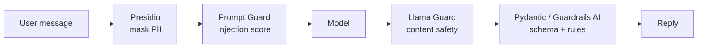

# Guardrail frameworks compared

## In one sentence

**Guardrail frameworks** are libraries and models that package common checks (injection and jailbreak detection, content safety, PII, output validation, topic control) so you don't build every check from scratch; the main open-source options are NeMo Guardrails, Guardrails AI, Llama Guard and Prompt Guard, Presidio and LLM Guard.

## Why it matters in 2027

You'll be asked to choose and justify one. Each solves a different slice of the problem, so most production systems combine two or three, plus hosted checks from their model provider. Knowing what each is good at saves weeks of trial and error.

## Explain it like I'm new

Home security. One company sells door locks, another sells cameras, another sells smoke detectors, and one sells a control panel that connects them all. You don't buy five control panels. You pick the panel and add the detectors you need.

## How it works

| Tool | What it is | Best for | Notes |
|---|---|---|---|
| [NeMo Guardrails](https://github.com/NVIDIA-NeMo/Guardrails) (NVIDIA) | A framework for defining input, output, dialog and retrieval "rails", using config files and a small language called Colang | Orchestrating several checks; keeping a bot on approved topics and flows | The "control panel". Can call other checkers, including Llama Guard and Presidio |
| [Guardrails AI](https://github.com/guardrails-ai/guardrails) | A Python library that runs "validators" on model output, with a hub of reusable validators | Structured output, format checks, reask-on-failure | Strong for "make sure output matches this schema and these rules" |
| [Llama Guard 4](https://huggingface.co/meta-llama/Llama-Guard-4-12B) (Meta) | An open model that classifies prompts and responses as safe or unsafe against a list of hazard categories | Content-safety classification you can self-host | Needs a GPU to run yourself; also available from some hosted providers |
| [Prompt Guard 2](https://huggingface.co/meta-llama/Llama-Prompt-Guard-2-86M) (Meta) | Small classifier models that detect prompt injection and jailbreak attempts | A fast first-pass injection filter | Small enough to run on CPU |
| [Presidio](https://microsoft.github.io/presidio/) (Microsoft) | PII detection and anonymization using patterns plus entity models | Finding and masking personal data | Add custom recognizers for Aadhaar, PAN, UPI IDs |
| [LLM Guard](https://github.com/protectai/llm-guard) (Protect AI) | A collection of input and output scanners (injection, PII, secrets, toxicity and more) | A ready-made set of scanners in one library | Easy to try, then keep only the scanners you need |
| Provider safety features | Hosted moderation and safety settings (OpenAI Moderation, Gemini safety settings, Azure prompt shields) | Zero-setup baseline | Only covers that provider's models; you can't tune much |

**How to choose:**

1. **Start with what your model provider gives you** and keep it on.
2. **Add PII handling** (Presidio or your own patterns) if you touch personal data. Almost everyone does.
3. **Add an injection classifier** (Prompt Guard or LLM Guard) if you read untrusted text, which RAG apps and agents always do.
4. **Add output validation** (Guardrails AI, or Pydantic plus your own checks) if code consumes model output.
5. **Add an orchestrator** (NeMo Guardrails) when you have enough rails that wiring them by hand gets messy.
6. **Measure** false positives, false negatives and added latency on your own data before rolling out ([evaluation](../05-evaluation/README.md)).

## Example

A typical layered setup for a support chatbot:

Project [P4](../projects/p4-guardrailed-support-agent/README.md) builds these layers in plain Python, so you can see exactly what each one does. Swapping in a framework later is then straightforward.

## Common mistakes

- **Installing everything.** Each layer adds latency and false positives. Add one, measure, then add the next.
- **Default thresholds forever.** Tune them on your own traffic.
- **No fallback when a guardrail service is down.** Decide whether to fail open (allow) or closed (block) for each check. For safety checks, closed is usually right.
- **Assuming English-only models work for Indian languages.** Test with Hindi, Hinglish and the other languages your users write in.

## Check yourself

1. Which tool would you pick to mask Aadhaar numbers, and what would you need to add?
2. What's the difference between Llama Guard and Prompt Guard?
3. When does an orchestrator like NeMo Guardrails become worth it?

Answers

1. Presidio, with a custom recognizer for the Aadhaar format (and ideally its checksum).
2. Llama Guard classifies content as safe or unsafe against hazard categories. Prompt Guard detects injection and jailbreak attempts.
3. When you have several rails (input, output, topic, retrieval) and wiring them together by hand becomes hard to maintain.

## Go deeper

- [NeMo Guardrails documentation](https://docs.nvidia.com/nemo/guardrails/latest/index.html) - Concepts and a getting-started guide. *Beginner · Docs · 30 min*
- [Llama Guard 4 model card](https://www.llama.com/docs/model-cards-and-prompt-formats/llama-guard-4/) by Meta - Hazard categories and prompt format. *Intermediate · Docs · 15 min*
- [LLM Guard](https://github.com/protectai/llm-guard) - Try its scanners in a notebook. *Beginner · Repo · 20 min*
