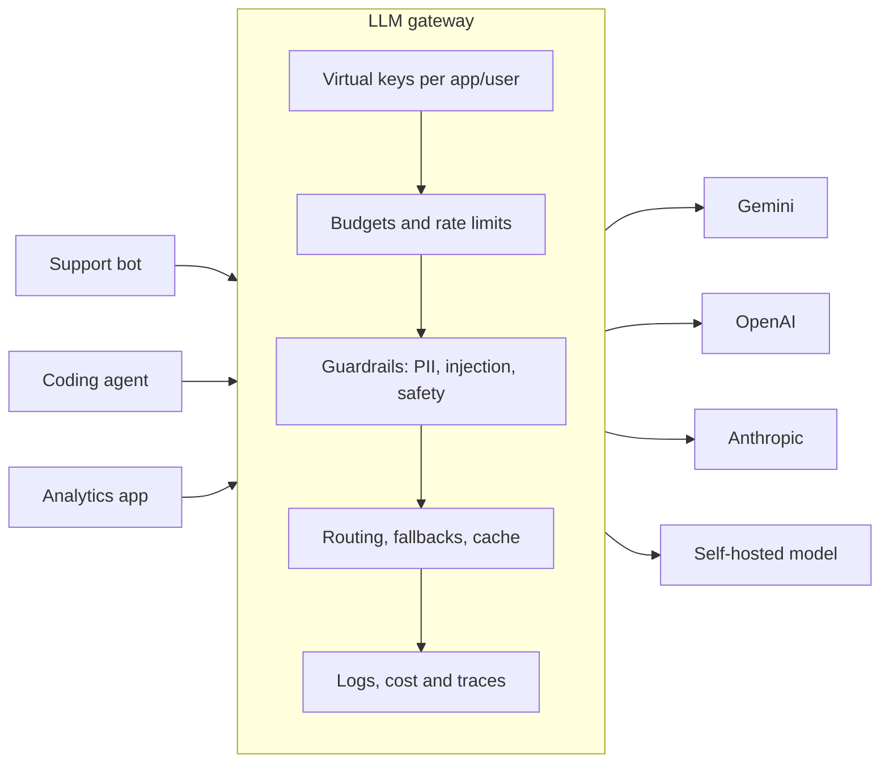

# LLM gateways

## In one sentence

An **LLM gateway** is a proxy that sits between your applications and model providers, so every model call goes through one place where you can enforce keys, budgets, rate limits, guardrails, logging, caching and fallbacks.

## Why it matters in 2027

Once a company has more than one AI app, calls to providers end up scattered across services, each with its own API key, logging and limits. A gateway brings this back under control. It's where platform and security teams enforce policy without changing every app, and it's the most practical defense against [unbounded consumption](../04-llm-security/unbounded-consumption.md).

## Explain it like I'm new

A company's travel desk. Employees don't each negotiate with airlines using the company card. They go through the desk, which checks the trip is approved, keeps within budget, books with preferred airlines (and a backup if the first is full), and keeps records. Employees still get where they're going; the company keeps control.

## How it works



Common gateway features:

| Feature | What it does |
|---|---|
| **Virtual keys** | Each app, team or user gets its own key. Real provider keys stay inside the gateway. Revoke one without touching others. |
| **Budgets and rate limits** | Per key: requests per minute, tokens per minute, spend per day or month |
| **Guardrails** | Run PII masking, injection checks and content filters centrally ([frameworks](guardrail-frameworks.md)) |
| **Routing and fallbacks** | Send requests to the cheapest suitable model; switch provider if one is down or rate-limited |
| **Caching** | Return stored answers for repeated identical (or very similar) requests |
| **Observability** | Log every call with cost, latency and token counts ([tracing](../07-agent-ops-production/observability-and-tracing.md)) |

**Options:** [LiteLLM proxy](https://docs.litellm.ai/docs/simple_proxy) (open source, self-hosted, OpenAI-compatible API), [Portkey](https://portkey.ai/docs), [Cloudflare AI Gateway](https://developers.cloudflare.com/ai-gateway/), and the gateways built into cloud platforms and API-management products. Because many expose an OpenAI-compatible API, apps can switch to a gateway by changing a base URL.

## Example

A minimal LiteLLM proxy config with a fallback and per-key budgets:

```yaml
# config.yaml  ->  run: uvx 'litellm[proxy]' --config config.yaml
model_list:
  - model_name: chat            # the name apps ask for
    litellm_params:
      model: gemini/gemini-3.5-flash-lite
      api_key: os.environ/GEMINI_API_KEY
  - model_name: chat-backup
    litellm_params:
      model: openai/gpt-5-mini
      api_key: os.environ/OPENAI_API_KEY

router_settings:
  fallbacks: [{"chat": ["chat-backup"]}]

general_settings:
  master_key: os.environ/LITELLM_MASTER_KEY
```

Then an admin creates a virtual key for the support bot with a $20 monthly budget and 60 requests per minute (see the [LiteLLM docs on virtual keys and budgets](https://docs.litellm.ai/docs/proxy/users)). The bot only ever sees its virtual key. Project [P4](../projects/p4-guardrailed-support-agent/README.md) implements the same ideas (per-user limits, budgets, provider choice) inside the app, so you can test them without running a proxy.

## Common mistakes

- **Giving apps the real provider keys** "temporarily". Temporary becomes permanent.
- **A gateway with no limits configured.** It's just an extra hop.
- **Logging full prompts with personal data** in the gateway. Mask first, or restrict log access and retention.
- **Single point of failure.** Run the gateway with redundancy, and decide what happens if it's down.

## Check yourself

1. Name four things a gateway can enforce centrally.
2. Why are virtual keys safer than sharing the real provider key?
3. What risk does a gateway itself introduce, and how do you handle it?

<details>
<summary>Answers</summary>

1. Any four of: per-app keys, budgets, rate limits, guardrails, routing and fallbacks, caching, logging and cost tracking.
2. The real key never leaves the gateway, each app's key has its own limits, and one key can be revoked without affecting others.
3. It becomes a single point of failure and a concentration of sensitive logs. Run it redundantly, mask or limit what it logs, and restrict who can access it.

</details>

## Go deeper

- [LiteLLM proxy quick start](https://docs.litellm.ai/docs/simple_proxy) - Run an open-source gateway locally. *Beginner · Docs · 20 min*
- [Guardrails in the LiteLLM proxy](https://docs.litellm.ai/docs/proxy/guardrails/quick_start) - Attaching checks at the gateway. *Intermediate · Docs · 15 min*
- [Cloudflare AI Gateway](https://developers.cloudflare.com/ai-gateway/) - A hosted alternative. *Beginner · Docs · 10 min*
