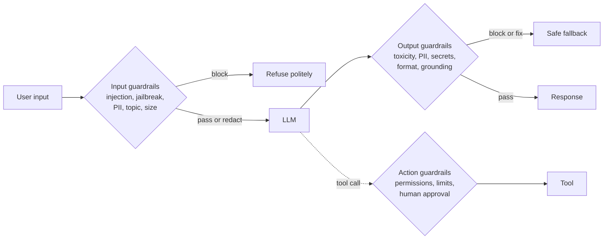

# What are guardrails?

## In one sentence

**Guardrails** are checks that run around an LLM, on what goes in, what comes out, and what actions it takes, to block or fix content that's unsafe, off-topic, private or malformed before it causes harm.

## Why it matters in 2027

Every company shipping AI to customers needs a clear answer to "what stops it from saying or doing something harmful?". Guardrails are a big part of that answer, and building, tuning and testing them is a core skill for AI engineers and the growing number of AI safety engineer roles. But they're one layer, not the whole defense. Knowing what they can't do matters as much as knowing what they can.

## Explain it like I'm new

Airport security. Bags are scanned on the way in (input checks), some items are checked on the way out (output checks), and certain doors need a badge no matter who you are (action checks). Security catches most problems, but not every one, which is why planes are also designed to survive things going wrong.

## How it works

| Type | Checks for | Typical method |
|---|---|---|
| **Input** | Prompt injection and jailbreak attempts, personal data, off-topic requests, oversized input | Classifier models, pattern rules, PII detectors, length limits |
| **Output** | Harmful or toxic content, leaked personal data or secrets, wrong format, ungrounded claims | Safety classifiers, schema validation, PII scanners, grounding checks |
| **Action** | Tool calls outside policy | Code checks, allowlists, rate limits, [human approval](../02-building-agents/human-in-the-loop.md) |

Methods, from cheapest to most expensive:

1. **Rules**: regex, allowlists, length limits, JSON schema validation. Fast, predictable, easy to bypass with rephrasing.
2. **Small classifiers**: models trained to detect one thing, like injection or toxicity. Fast and fairly accurate on known patterns.
3. **LLM-based checks**: a second model judges the input or output against a policy. Flexible and slower, and can be fooled the same way the main model can.

**Trade-offs to tune:**

- **False positives** (blocking legitimate requests) annoy users and make them work around your product.
- **False negatives** (missing attacks) are the security failures.
- **Latency and cost**: every check adds time. Run cheap checks first and in parallel where possible.

You measure all three with [evals](../05-evaluation/README.md).

## Example

A banking assistant's guardrails, in order:

1. Input over 4,000 characters is rejected.
2. Card numbers and Aadhaar numbers in the input are masked before the model sees them ([PII and privacy](pii-and-privacy.md)).
3. A prompt-injection classifier scores the input. High score: refuse and log.
4. A topic check keeps it to banking. "Write my college essay" gets a polite refusal.
5. The model answers.
6. Output is checked for personal data, for account numbers that don't belong to this user, and for promises like "you are approved for a loan".
7. Any money movement goes through a tool that enforces limits and requires the user to confirm.

Project [P4](../projects/p4-guardrailed-support-agent/README.md) builds a version of this.

## Common mistakes

- **Treating guardrails as the main security control.** They reduce risk. Permissions and design limit damage when they miss.
- **Never measuring false positives.** Overblocking quietly ruins the product.
- **Only checking input.** Indirect injection arrives in documents and tool results, and harmful output can come from harmless-looking input.
- **Using the same model as both worker and judge** without testing whether the judge can be fooled.

## Check yourself

1. What are the three places guardrails can sit?
2. What's the trade-off between false positives and false negatives?
3. Why aren't guardrails enough on their own?

Answers

1. On input, on output, and on actions (tool calls).
2. Tightening checks catches more attacks (fewer false negatives) but blocks more legitimate requests (more false positives), and the reverse.
3. Classifiers and rules miss new attack phrasings. When they miss, only design controls like least privilege and approvals limit the damage.

## Go deeper

- [NeMo Guardrails documentation](https://docs.nvidia.com/nemo/guardrails/latest/index.html) by NVIDIA - Input, output and dialog rails explained. *Beginner · Docs · 20 min*
- [Llama Guard: LLM-based Input-Output Safeguard](https://arxiv.org/abs/2312.06674) - How a safety classifier model is built. *Intermediate · Paper · 25 min*
- [Moderation guide](https://platform.openai.com/docs/guides/moderation) by OpenAI - A free hosted content classifier. *Beginner · Docs · 10 min*
