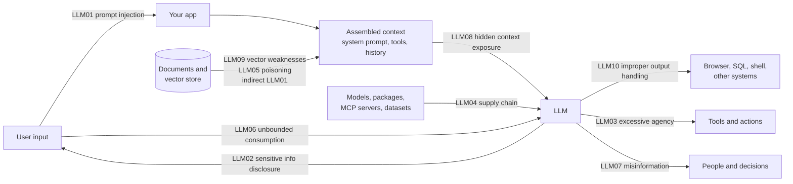

# 04 · LLM security

How LLM applications get attacked, and how to defend them. This module follows the **OWASP Top 10 for LLM Applications**, the list most security teams, auditors and interviewers use, plus the OWASP list for agents.

**You'll be able to:** point at any part of an LLM app's architecture and name the risks there, explain each risk with an example, and choose defenses that still hold when the model is fooled.

> [!IMPORTANT]
> **Which edition?** OWASP published the **2026** edition of the LLM Top 10 in August 2026 ([resource page](https://genai.owasp.org/resource/owasp-genai-llm-top-10-2026/)). Many courses, blog posts and job descriptions still use **2025** numbering. The notes below follow 2026 and show the 2025 ID next to each, so you can read either.

## The big idea

OWASP's 2026 edition opens with advice that sums up this whole module: stop trying to build a model that can't be fooled, and build the system around it so that when the model *is* fooled, nothing important breaks. Every defense below follows from that. Assume the model will sometimes follow the wrong instructions, and limit what it can reach, what it can do, and what its output can trigger.

## Where the risks live

## The ten risks

| 2026 | Risk | 2025 ID | One-line summary |
|---|---|---|---|
| LLM01 | [Prompt injection](prompt-injection.md) | LLM01 | Text the model reads changes what it does |
| LLM02 | [Sensitive information disclosure](sensitive-information-disclosure.md) | LLM02 | Private data leaks through answers, logs or tools |
| LLM03 | [Excessive agency](excessive-agency.md) | LLM06 | The model can do more than its job needs |
| LLM04 | [Supply chain](supply-chain.md) | LLM03 | A model, package, dataset or plugin you depend on is compromised |
| LLM05 | [Data and model poisoning](data-and-model-poisoning.md) | LLM04 | Training, fine-tuning or retrieved data is tampered with |
| LLM06 | [Unbounded consumption](unbounded-consumption.md) | LLM10 | Attackers run up your bill or take your service down |
| LLM07 | [Misinformation](misinformation.md) | LLM09 | Confident wrong output drives a decision or action |
| LLM08 | [Hidden context exposure](hidden-context-exposure.md) | LLM07 (System prompt leakage) | Hidden instructions, tool schemas or secrets get extracted |
| LLM09 | [Vector and embedding weaknesses](vector-and-embedding-weaknesses.md) | LLM08 | Retrieval returns poisoned, leaked or wrong-tenant data |
| LLM10 | [Improper output handling](improper-output-handling.md) | LLM05 | Model output is trusted by a browser, database or shell |

## Beyond the Top 10

| Note | What it covers |
|---|---|
| [Agentic threats](agentic-threats.md) | The OWASP Top 10 for Agentic Applications (ASI01 to ASI10), for models that act |
| [Real incidents](real-incidents.md) | Verified cases, what failed, and which risk each maps to |
| [Frameworks: MITRE ATLAS and NIST AI RMF](frameworks-atlas-nist.md) | The other frameworks you'll see in security and compliance work |

## Suggested order

Read [prompt injection](prompt-injection.md), [excessive agency](excessive-agency.md) and [improper output handling](improper-output-handling.md) first. Together they explain most real attacks. Then do project [P2 · Secure RAG assistant](../projects/p2-secure-rag/README.md), where you attack a RAG app and then defend it.

> [!CAUTION]
> Only test attacks against systems you own or have written permission to test. Practice on the deliberately vulnerable apps linked in each note.

**Next:** [05 · Evaluation](../05-evaluation/README.md)
