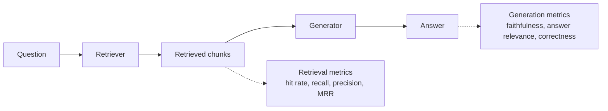

# Measuring RAG quality

## In one sentence

RAG quality is measured in two halves: **retrieval metrics** check whether the right chunks were found, and **generation metrics** check whether the answer is faithful to those chunks and actually answers the question.

## Why it matters in 2027

When a RAG app gives a wrong answer, the cause is usually retrieval, not the model. Without separate metrics, teams waste weeks tweaking prompts when the real fix is chunking, search or filters. These metrics also catch security-relevant failures: answers that go beyond the sources, and retrieval that returns data the user shouldn't see.

## Explain it like I'm new

A student answering exam questions from a textbook. Two things can go wrong: they open the wrong pages (retrieval), or they read the right pages and still write something the pages don't say (generation). You'd grade those separately, because the fixes are different: a better index, or better reading.

## How it works



**Retrieval metrics** (need a dataset with the IDs of the chunks that *should* be found):

| Metric | Question it answers |
|---|---|
| **Hit rate @k** | Was at least one relevant chunk in the top k? |
| **Recall @k** | What fraction of all relevant chunks were in the top k? |
| **Precision @k** | What fraction of the top k were relevant? |
| **MRR** (mean reciprocal rank) | How high up was the first relevant chunk, on average? |

**Generation metrics:**

| Metric | Question it answers | Usually graded by |
|---|---|---|
| **Faithfulness** (groundedness) | Is every claim supported by the retrieved chunks? | [LLM judge](llm-as-judge.md) |
| **Answer relevance** | Does it actually answer the question asked? | LLM judge |
| **Correctness** | Does it match the reference answer? | Code (if exact) or LLM judge |
| **Citation accuracy** | Do the cited sources support the cited sentences? | LLM judge or code |
| **Abstention** | When the answer isn't in the sources, does it say so? | Code |

**Security checks** worth adding to the same suite: did any retrieved chunk belong to another tenant? Did the answer include links or content from a quarantined source? (See [P2](../projects/p2-secure-rag/README.md).)

Libraries like [Ragas](https://docs.ragas.io/) implement most of these. Understand the definitions first so you can interpret the numbers.

## Example

Computing retrieval metrics by hand:

```python
# test: run
def hit_rate(retrieved: list[str], relevant: set[str]) -> float:
    return 1.0 if relevant & set(retrieved) else 0.0

def recall(retrieved: list[str], relevant: set[str]) -> float:
    return len(relevant & set(retrieved)) / len(relevant)

def reciprocal_rank(retrieved: list[str], relevant: set[str]) -> float:
    return next((1 / (i + 1) for i, doc in enumerate(retrieved) if doc in relevant), 0.0)

cases = [
    (["leave-policy", "expenses", "wfh"], {"leave-policy"}),
    (["expenses", "it-help", "leave-policy"], {"leave-policy", "carry-over"}),
    (["wfh", "it-help", "expenses"], {"parking"}),
]
n = len(cases)
print("hit rate @3:", round(sum(hit_rate(r, rel) for r, rel in cases) / n, 2))  # 0.67
print("recall @3:  ", round(sum(recall(r, rel) for r, rel in cases) / n, 2))  # 0.5
print("MRR:        ", round(sum(reciprocal_rank(r, rel) for r, rel in cases) / n, 2))  # 0.44
```

The third case finds nothing relevant, so the generator can't succeed however good the prompt is. That's a retrieval problem: maybe the parking policy was never indexed.

## Common mistakes

- **Only measuring the final answer.** You can't tell retrieval failures from generation failures.
- **Trusting high faithfulness alone.** An answer can be perfectly faithful to the wrong chunks.
- **No abstention cases.** Include questions the documents don't answer.
- **Changing chunking and prompts at the same time.** Change one thing, re-run, compare.

## Check yourself

1. What's the difference between faithfulness and correctness?
2. Hit rate is 0.95 but correctness is 0.6. Where do you look first?
3. Why include questions whose answers aren't in the documents?

<details>
<summary>Answers</summary>

1. Faithfulness checks that the answer is supported by the retrieved chunks. Correctness checks that it matches the true answer. An answer can be faithful to wrong or outdated chunks and still be incorrect.
2. Generation: the right chunks are usually being found, so the problem is how the model uses them (prompt, model, context order or length).
3. To test abstention: the system should say it can't find the answer instead of making one up.

</details>

## Go deeper

- [Ragas documentation](https://docs.ragas.io/) - Definitions and implementations of the common RAG metrics. *Intermediate · Docs · 30 min*
- [Introducing Contextual Retrieval](https://www.anthropic.com/news/contextual-retrieval) by Anthropic - A worked example of measuring retrieval improvements. *Intermediate · Article · 15 min*
- [RAGAS: Automated Evaluation of Retrieval Augmented Generation](https://arxiv.org/abs/2309.15217) - The paper behind the library. *Intermediate · Paper · 25 min*
