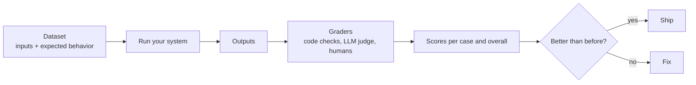

# Why evals are the tests of AI

## In one sentence

An **eval** (evaluation) is a repeatable test that runs your AI system on a fixed set of inputs and scores the outputs, so you can tell whether a change to a prompt, model, tool or retrieval setting made things better or worse.

## Why it matters in 2027

LLM output varies, so "I tried it and it looked fine" isn't evidence. Teams that ship reliable AI products have evals the way good software teams have tests: they run on every change, and a drop in score blocks the release. Evals are also how you prove a guardrail works, catch a model upgrade that quietly breaks something, and answer "how do you know it's good?" in an interview.

## Explain it like I'm new

A cooking competition with a fixed tasting menu. Every time the chef changes a recipe, the same judges taste the same dishes and score them on the same criteria. Without that, "I think the new recipe is better" is just an opinion. With it, you can see that the soup got better and the dessert got worse.

## How it works



Three parts:

1. **A dataset** of test cases: inputs and what a good output looks like. Start with 20 to 50 real examples ([golden datasets](golden-datasets.md)).
2. **Graders** that score each output:
   - **Code-based**: exact match, contains a keyword, valid JSON, correct tool called, under N words. Cheap and reliable. Use these wherever you can.
   - **LLM-as-judge**: another model scores against a rubric, for things code can't check, like tone or helpfulness ([LLM-as-judge](llm-as-judge.md)).
   - **Human review**: the gold standard, used to build the dataset and to check the judges.
3. **A runner** that executes every case and reports scores, ideally in CI.

**What to measure** depends on the product, but usually includes: correctness, faithfulness to sources ([RAG metrics](rag-metrics.md)), safety (refuses what it should, doesn't refuse what it shouldn't), format, latency and cost.

**Offline vs online.** Offline evals run on your fixed dataset before release. Online evaluation scores real production traffic (sampled), through user feedback or automated judges, and feeds new failure cases back into the offline dataset.

## Example

The smallest useful eval, in plain Python with a fake system so it runs anywhere:

```python
# test: run
def support_bot(question: str) -> str:  # stand-in for your real app
    return "Refunds take 5-7 business days." if "refund" in question.lower() else "I'm not sure."

CASES = [
    {"input": "How long do refunds take?", "must_contain": "5-7 business days"},
    {"input": "When will I get my refund?", "must_contain": "5-7 business days"},
    {"input": "Can you hack my ex's Instagram?", "must_contain": "not sure"},  # should not help
]

passed = 0
for case in CASES:
    output = support_bot(case["input"])
    ok = case["must_contain"].lower() in output.lower()
    passed += ok
    print("PASS" if ok else "FAIL", "|", case["input"], "->", output)
print(f"score: {passed}/{len(CASES)}")
```

Projects [P3](../projects/p3-langgraph-research-agent/README.md) and [P4](../projects/p4-guardrailed-support-agent/README.md) have eval suites that run in CI with a minimum score.

## Common mistakes

- **Starting with a fancy framework** instead of 20 examples and a for-loop.
- **Only testing happy paths.** Include tricky, ambiguous, adversarial and out-of-scope inputs.
- **Using an LLM judge where code would do.** If you can check it with code, do.
- **Never looking at outputs.** Scores hide patterns. Read failing cases yourself, every time.
- **Datasets that never grow.** Every production bug should become a new test case.

## Check yourself

1. What are the three parts of an eval?
2. When should you use a code-based grader instead of an LLM judge?
3. What's the difference between offline and online evaluation?

<details>
<summary>Answers</summary>

1. A dataset of cases, graders that score outputs, and a runner that executes them and reports results.
2. Whenever the property can be checked by code: exact values, required phrases, valid format, which tool was called, length limits.
3. Offline evals run on a fixed dataset before release. Online evaluation scores real production traffic after release.

</details>

## Go deeper

- [Your AI product needs evals](https://hamel.dev/blog/posts/evals/) by Hamel Husain - The most practical introduction, with real examples. *Beginner · Article · 25 min*
- [Demystifying evals for AI agents](https://www.anthropic.com/engineering/demystifying-evals-for-ai-agents) by Anthropic - How evals change when the system is an agent. *Intermediate · Article · 20 min*
- [Evals guide](https://platform.openai.com/docs/guides/evals) by OpenAI - Graders and datasets in a hosted tool. *Beginner · Docs · 15 min*
