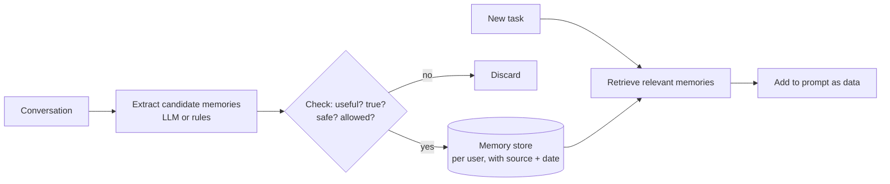

# How agents remember

## In one sentence

**Agent memory** is everything an agent can draw on beyond the current request: **short-term memory** (the conversation and working state of the current task) and **long-term memory** (facts, preferences and past experiences saved across sessions and retrieved when relevant).

## Why it matters in 2027

Users now expect assistants to remember them, and agents that work on long tasks need to keep track of what they've done. Memory is also where agents go wrong in two opposite ways: they forget what matters, or they remember the wrong thing (a mistake, a stale fact, an attacker's planted instruction) and keep acting on it. Good memory design is a mix of product design, data engineering and security.

## Explain it like I'm new

A doctor's practice. During your appointment, the doctor keeps track of what you've said so far (short-term). Your patient file holds your allergies, past diagnoses and preferences (long-term). The doctor doesn't reread your whole file each visit, just the relevant parts. And if someone wrote a wrong allergy in your file, every future doctor would trust it.

## How it works

| Type | What it holds | Where it usually lives | Lifetime |
|---|---|---|---|
| **Short-term (working)** | Messages in this conversation, intermediate results, the current plan | The [context window](../00-foundations/tokens-and-context-windows.md), plus a checkpointer such as LangGraph's | One conversation or task |
| **Long-term: semantic** | Facts and preferences: "prefers answers in Hindi", "works on the payments team" | A database or vector store, keyed by user | Until changed or deleted |
| **Long-term: episodic** | Past experiences: "last time this report failed because the API timed out" | Logs or a vector store of summaries | Weeks to months |
| **Long-term: procedural** | How to do things: instructions, [skills](../01-coding-agents/skills.md), learned rules | Prompts, skill files, memory files | Until revised |

**Short-term memory management.** Conversations outgrow the context window. Common fixes: keep the last N turns, summarize older turns, or drop tool outputs once they've been used.

**Long-term memory flow:**



Writing memories (when, what, with what checks) matters more than reading them. That's where [poisoning](memory-poisoning.md) and [privacy](memory-privacy.md) problems start.

## Example

LangGraph separates the two kinds: a **checkpointer** saves short-term state per conversation thread, and a **store** saves long-term memories per user across threads. This runs offline:

```python
# test: run
from langgraph.store.memory import InMemoryStore

store = InMemoryStore()
user = ("memories", "user-42")  # namespace: one per user, so users never see each other's memories

store.put(user, "lang", {"fact": "Prefers answers in Hindi", "source": "user said so", "date": "2026-11-02"})
store.put(user, "team", {"fact": "Works on the payments team", "source": "profile", "date": "2026-10-15"})

for item in store.search(user):
    print(item.key, "->", item.value["fact"], f"({item.value['source']}, {item.value['date']})")
```

In a real app you'd add embeddings to the store so `search` can find memories relevant to the current question. Project [P3](../projects/p3-langgraph-research-agent/README.md) uses both a checkpointer and a store.

## Common mistakes

- **Saving everything.** Memory fills with noise and old facts. Save only what will help later.
- **No source or date on memories.** You can't judge or expire what you can't trace.
- **One shared memory space for all users.** Always namespace by user (and tenant).
- **Treating memories as instructions.** Retrieved memories are data, like RAG chunks.
- **No way for users to see or delete what's remembered.**

## Check yourself

1. What's the difference between short-term and long-term memory for an agent?
2. Name the three kinds of long-term memory.
3. Why should every memory record its source and date?

<details>
<summary>Answers</summary>

1. Short-term memory is the state of the current conversation or task, held in the context and a checkpointer. Long-term memory is saved across sessions and retrieved when relevant.
2. Semantic (facts and preferences), episodic (past experiences), procedural (how to do things).
3. So you can judge how much to trust it, expire stale entries, trace poisoning, and honor deletion requests.

</details>

## Go deeper

- [Memory overview](https://docs.langchain.com/oss/python/concepts/memory) by LangChain - Short-term and long-term memory, with the semantic, episodic and procedural split. *Beginner · Docs · 15 min*
- [LLM Powered Autonomous Agents](https://lilianweng.github.io/posts/2023-06-23-agent/) by Lilian Weng - The classic overview of planning, memory and tools. *Intermediate · Article · 30 min*
- [MemGPT: Towards LLMs as Operating Systems](https://arxiv.org/abs/2310.08560) - Treating context like RAM and long-term memory like disk. *Intermediate · Paper · 30 min*
