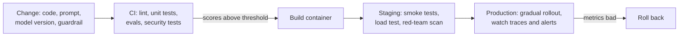

# Deploying an AI app

## In one sentence

Deploying an AI app means packaging it (usually as a container), running it somewhere with its secrets kept safe, putting checks in the pipeline so a bad prompt or model change can't ship unnoticed, and being able to roll back quickly.

## Why it matters in 2027

In AI apps, behavior can change without any code change: you edit a prompt, the provider updates a model, or a document in the knowledge base changes. A safe deployment process treats prompts, model versions, guardrail settings and eval datasets as versioned parts of the release, not as things someone tweaks in a dashboard.

## Explain it like I'm new

Opening a new branch of a restaurant chain. You don't just send a chef with a recipe in their head. You send the same written recipes (versioned prompts), the same ingredients from approved suppliers (pinned models and packages), a health inspection before opening (CI evals), and a plan to close the branch quickly if customers get sick (rollback).

## How it works



**A deployment checklist:**

- **Version everything that changes behavior**: prompts in Git, model names pinned to specific versions, guardrail thresholds in config, eval datasets in Git.
- **Gate on evals.** CI runs the [eval suite](../05-evaluation/why-evals.md) on every change. Security cases must pass 100%.
- **Secrets** come from the platform's secret store or environment variables, never the image or the repo.
- **Container basics**: a small base image, pinned dependencies (lockfile), and running as a non-root user.
- **Least privilege at runtime**: the app's database account, API keys and network access are limited to what it needs.
- **Health checks** so the platform restarts broken instances.
- **Gradual rollout**: send a small share of traffic to the new version first, compare metrics, then expand. Some teams also run **shadow tests**, sending copies of real requests to the new version without showing its answers to users.
- **Rollback** in one command, including reverting prompt and model changes.
- **Observability on from day one** ([tracing](observability-and-tracing.md)), with alerts on errors, latency, cost and guardrail rates.

**Where to run it.** Any platform that runs containers works: cloud container services, Kubernetes, or simpler platforms for side projects. For learning, `docker compose` on your laptop is enough.

## Example

Project [P5](../projects/p5-production-capstone/README.md) packages the P4 agent. A simplified version of its Dockerfile:

```dockerfile
FROM python:3.12-slim
COPY --from=ghcr.io/astral-sh/uv:0.12.1 /uv /usr/local/bin/uv
WORKDIR /app/p5-production-capstone
COPY . /app
RUN uv sync --locked --no-dev          # pinned dependencies from uv.lock
RUN useradd --create-home --uid 10001 app
USER app                                 # never run as root
HEALTHCHECK CMD python -c "import urllib.request; urllib.request.urlopen('http://127.0.0.1:8000/healthz')"
CMD [".venv/bin/uvicorn", "capstone.app:app", "--host", "0.0.0.0", "--port", "8000"]
```

`docker compose up` runs it next to Jaeger, so you can open the trace UI and watch each request's model and tool calls.

## Common mistakes

- **Editing prompts in production** without review or versioning.
- **Using a model alias like "latest"** in production. It can change under you.
- **API keys baked into images** or committed `.env` files.
- **Running containers as root** with broad network access.
- **No rollback plan for data changes**, such as re-indexing the knowledge base. Keep the previous index until the new one is proven.

## Check yourself

1. Name three things besides code that should be versioned in an AI app release.
2. What should CI check before a prompt change can ship?
3. Why run containers as a non-root user?

<details>
<summary>Answers</summary>

1. Any three of: prompts, model versions, guardrail settings and thresholds, eval datasets, knowledge-base indexes.
2. Unit tests, the eval suite with minimum scores (100% on security cases), and lint and security checks.
3. If the app is compromised, the attacker gets fewer rights inside the container and finds it harder to escape or do damage.

</details>

## Go deeper

- [FastAPI deployment concepts](https://fastapi.tiangolo.com/deployment/) - Workers, HTTPS, restarts and containers, explained simply. *Beginner · Docs · 30 min*
- [Docker getting started](https://docs.docker.com/get-started/) - Images, containers and compose. *Beginner · Docs · 1 h*
- [Building A Generative AI Platform](https://huyenchip.com/2024/07/25/genai-platform.html) by Chip Huyen - How the deployment pieces fit together. *Intermediate · Article · 40 min*
