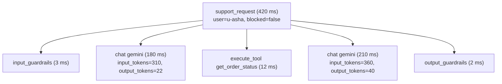

# Observability and tracing

## In one sentence

**Observability** for AI apps means recording what happened inside every request (each model call, tool call, guardrail decision, token count, latency and cost) as a connected **trace**, so you can explain any answer, debug failures and spot problems before users report them.

## Why it matters in 2027

An agent can make ten model calls and five tool calls to answer one question. When the answer is wrong, slow or expensive, "check the logs" doesn't work unless those steps are linked together. Traces are also where you find attacks in progress, measure guardrail block rates, and collect real failures for your [eval dataset](../05-evaluation/golden-datasets.md). OWASP's agentic list names full tracing as a first control against cascading failures.

## Explain it like I'm new

A parcel tracking page. You don't just see "delivered" or "lost". You see every step: picked up in Pune, sorted in Mumbai, out for delivery, with times. When something goes wrong, you know exactly where. A trace is that tracking page for one user request through your AI system.

## How it works

A **trace** is a tree of **spans**. Each span is one step, with a start time, a duration and attributes (key-value details).



**What to record:**

| Level | Attributes |
|---|---|
| Request | User ID (pseudonymous), feature, final status, blocked or not and why, total latency, total cost |
| Model call | Model name and version, input/output tokens, latency, finish reason, cache hit |
| Tool call | Tool name, success or error, latency |
| Guardrails | Which checks ran, which fired |

**Standards and tools.** OpenTelemetry is the open standard for traces, and it has **GenAI semantic conventions**: agreed attribute names like `gen_ai.request.model` and `gen_ai.usage.input_tokens`, so different tools can read your traces. Tools built for LLM apps, such as [Langfuse](https://langfuse.com/docs) (open source), add prompt management, cost dashboards and evaluation on top of traces. General tools like Jaeger, Grafana and cloud monitoring services can display the same OpenTelemetry data.

**Privacy.** Prompts and replies often contain personal data. Decide deliberately whether traces store text. A safe default is to store lengths, counts and decisions, and keep full text only in a short-retention, access-controlled store for debugging ([memory and privacy](../06-agent-memory/memory-privacy.md)).

**From traces to action:** set alerts on error rate, p95 latency, cost per hour and guardrail block rate. A sudden jump in blocks may mean an attack. A sudden drop may mean a guardrail broke.

## Example

Project [P5](../projects/p5-production-capstone/README.md) wraps the P4 agent with OpenTelemetry spans without changing P4's code:

```python
with tracer.start_as_current_span(f"chat {model}") as span:
    span.set_attribute("gen_ai.operation.name", "chat")
    span.set_attribute("gen_ai.request.model", model)
    out = llm.chat(messages, tools)
    span.set_attribute("gen_ai.usage.input_tokens", out["usage"]["input"])
    span.set_attribute("gen_ai.usage.output_tokens", out["usage"]["output"])
```

Its tests check that every request produces one connected trace and that no message text or card numbers ever appear in span attributes.

## Common mistakes

- **Logging separate lines instead of linked spans.** You can't follow one request across ten calls.
- **Storing full prompts forever.** Traces become your biggest store of personal data.
- **No model version in traces.** When quality changes, you can't tell if the provider changed the model.
- **Collecting traces nobody looks at.** Review a sample of real traces every week and turn failures into eval cases.

## Check yourself

1. What's the difference between a trace and a span?
2. Name four attributes worth recording on every model-call span.
3. Why might a sudden *drop* in guardrail blocks be a warning sign?

<details>
<summary>Answers</summary>

1. A span is one step (a model call, a tool call). A trace is the tree of all spans for one request.
2. Any four of: model name and version, input tokens, output tokens, latency, finish reason, cache hit, cost.
3. It may mean a guardrail stopped working (a bad deploy, an expired key for a classifier service), not that attacks stopped.

</details>

## Go deeper

- [OpenTelemetry semantic conventions for GenAI](https://opentelemetry.io/docs/specs/semconv/gen-ai/) - The standard attribute names. *Intermediate · Spec · 20 min*
- [Langfuse documentation](https://langfuse.com/docs) - Open-source tracing, cost tracking and evals for LLM apps. *Beginner · Docs · 20 min*
- [Building A Generative AI Platform](https://huyenchip.com/2024/07/25/genai-platform.html) by Chip Huyen - Where observability fits in a full AI platform. *Intermediate · Article · 40 min*
