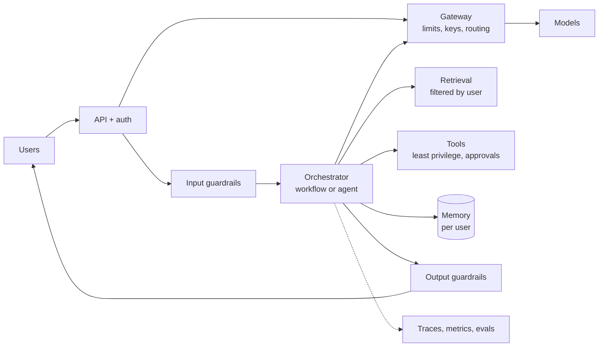

# AI system design fundamentals

## In one sentence

**AI system design** is deciding how the parts of an AI product fit together (models, retrieval, tools, memory, guardrails, gateway, evals, observability) and making explicit trade-offs between quality, cost, latency, safety and simplicity for a specific use case.

## Why it matters in 2027

Building one agent is now easy. Designing a system that is accurate, affordable, secure, compliant and still working a year later is not. That's why AI system design interviews are common for AI engineering roles, and why the skills in modules 03 to 07 matter most when combined. This note gives you a repeatable way to approach any design question.

## Explain it like I'm new

Designing a house, not just choosing bricks. You start with who lives there and what they need, then decide rooms, plumbing, wiring and locks, knowing that a bigger kitchen means a smaller garden. An architect's value is in those trade-offs, explained clearly.

## How it works

**A seven-step approach** (works for interviews and real projects):

1. **Clarify the job.** Who are the users, what decisions or actions does the system support, and what happens if it's wrong? A wrong movie recommendation and a wrong medicine dose need very different designs.
2. **Set targets.** Quality bar (how measured), p95 latency, cost per task, traffic, languages, data sensitivity, regulations.
3. **Pick the simplest shape** that can work: one call, a [workflow](../02-building-agents/when-not-to-use-agents.md), or an [agent](../02-building-agents/the-agent-loop.md).
4. **Design the data path**: what data the model needs, where it comes from, how it's kept fresh, and who may see what ([RAG](../00-foundations/rag-in-one-page.md), [vector weaknesses](../04-llm-security/vector-and-embedding-weaknesses.md)).
5. **Design the action path**: which tools, with what permissions, and which actions need [human approval](../02-building-agents/human-in-the-loop.md).
6. **Add the safety layers**: [guardrails](../03-ai-safety-guardrails/README.md), a [gateway](../03-ai-safety-guardrails/llm-gateways.md) with limits, and a [threat model](threat-modeling.md).
7. **Plan how you'll know it works**: [evals](../05-evaluation/README.md) before release, [tracing](../07-agent-ops-production/observability-and-tracing.md) and alerts after.

**A reference architecture** most designs are a variation of:

**Common trade-offs:**

| Choice | Option A | Option B | Decide by |
|---|---|---|---|
| Model size | Large: better reasoning | Small: cheaper, faster | Route: small by default, large when needed; measure with evals |
| Knowledge | RAG: fresh, citable | Fine-tuning: style and format | How often facts change; need for citations |
| Control flow | Workflow: predictable | Agent: flexible | Whether steps can be known in advance |
| Hosting | API provider: easy | Self-hosted: data control | Data sensitivity, cost at scale, team skills |
| Autonomy | Act automatically | Human approves | Cost of a wrong action; reversibility |
| Guardrails | More checks: safer | Fewer checks: faster, fewer false blocks | Measured false-positive rate and risk |

## Example

**Question:** "Design an assistant that helps a bank's call-center staff answer customer questions."

A strong first answer covers: users are trained staff, not customers, so the assistant drafts and staff decide (lower autonomy risk). Answers must cite policy documents (RAG with citations, abstain when unsure). Customer data is retrieved only for the customer on the current call, using the staff member's permissions. No tools that move money. PII is masked in logs. Evals include policy questions, Hindi and Hinglish, and adversarial cases. Latency target is under 3 seconds to first token, because staff are on a live call. Compliance with RBI guidelines and the DPDP Act is checked with the bank's legal team.

The [case studies](case-study-support-agent.md) in this module work through full designs.

## Common mistakes

- **Jumping to architecture** before clarifying users, risks and targets.
- **Designing for the happy path only.** Say what happens when the model is wrong, slow or attacked.
- **Choosing an agent by default.** Justify autonomy.
- **No measurement plan.** "We'll use a good model" isn't a quality plan.

## Check yourself

1. What are the seven steps of the design approach?
2. Why does "what happens if it's wrong?" come first?
3. When would you self-host a model instead of using an API?

Answers

1. Clarify the job, set targets, pick the simplest shape, design the data path, design the action path, add safety layers, plan measurement.
2. The cost of mistakes decides how much autonomy, verification, human review and safety work the design needs.
3. When data can't leave your environment, when cost at very high volume favors it, or when you need control over model versions, and your team can operate it.

## Go deeper

- [Building A Generative AI Platform](https://huyenchip.com/2024/07/25/genai-platform.html) by Chip Huyen - A full reference architecture, built up one component at a time. *Intermediate · Article · 40 min*
- [Patterns for Building LLM-based Systems & Products](https://martinfowler.com/articles/gen-ai-patterns/) on martinfowler.com - Named patterns with trade-offs. *Intermediate · Article · 45 min*
- [System Design Primer](https://github.com/donnemartin/system-design-primer) - General system design fundamentals (scaling, caching, queues). *Beginner · Repo · browse*
