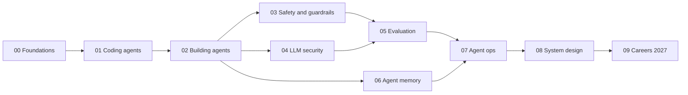

<!-- markdownlint-disable-file MD041 -->

  <picture>
    <source media="(prefers-color-scheme: dark)" srcset="assets/logo-wordmark-dark.svg">
    
  </picture>

  <a href="https://ai-engineering.neuralsaasai.com/"><strong>Read the website</strong></a> ·
  <a href="START-HERE.md">Start here</a> ·
  <a href="#modules">Modules</a> ·
  <a href="#projects">Projects</a> ·
  <a href="glossary.md">Glossary</a>

# AI Engineering Playbook

A free, open-source guide to the AI engineering skills that matter in 2027, from your first LLM API call to building AI agents and securing them in production. Written for beginners to intermediates, with the focus on understanding: short plain-language notes on coding agents, LangGraph agents, guardrails, LLM security (OWASP LLM Top 10), evals, agent memory and AI system design, with diagrams, self-checks, carefully chosen sources, and five hands-on projects.

> [!TIP]
> New here? Take the two-minute self-check in [START-HERE.md](START-HERE.md) to find your starting module.

## Why this playbook

Building an AI agent is no longer the hard part. Coding agents write most of the code, and frameworks give you the agent loop. What companies now need are engineers who can make AI systems **safe, secure, measurable and reliable**: people who know how agents get attacked, how to prove an answer is right, and how to keep costs and failures under control. This playbook is built around that shift.

## Learning path

## Modules

| # | Module | You'll be able to | Project |
|---|---|---|---|
| 00 | [Foundations](00-foundations/README.md) | Explain LLMs, tokens, embeddings and RAG; call a model from code | |
| 01 | [Coding agents](01-coding-agents/README.md) | Direct a coding agent with `AGENTS.md`, skills, MCP and a spec-to-review workflow | [P1](projects/p1-agent-built-cli/README.md) |
| 02 | [Building agents](02-building-agents/README.md) | Build LangGraph agents with tools, checkpoints and human approval | [P3](projects/p3-langgraph-research-agent/README.md) |
| 03 | [AI safety and guardrails](03-ai-safety-guardrails/README.md) | Design input, output and action guardrails; handle PII; use a gateway | [P4](projects/p4-guardrailed-support-agent/README.md) |
| 04 | [LLM security](04-llm-security/README.md) | Explain and defend against every OWASP LLM Top 10 (2026) and agentic risk | [P2](projects/p2-secure-rag/README.md) |
| 05 | [Evaluation](05-evaluation/README.md) | Build eval sets, LLM judges and red-team scans | P3, P4 |
| 06 | [Agent memory](06-agent-memory/README.md) | Design memory that resists poisoning and respects privacy | P3 |
| 07 | [Agent ops and production](07-agent-ops-production/README.md) | Trace, cost, load-test and deploy AI services | [P5](projects/p5-production-capstone/README.md) |
| 08 | [AI system design](08-ai-system-design/README.md) | Design, threat-model and check compliance for real systems | P5 |
| 09 | [Careers in 2027](09-careers-2027/README.md) | Map skills to roles, build a portfolio, follow a 90-day plan | |

## Projects

Every project runs and passes its tests **without an API key**, using fake models. Add a free Gemini key (or any provider via LiteLLM) to try it with a real model.

| Project | What you build | Tests |
|---|---|---|
| [P1 · Agent-built CLI](projects/p1-agent-built-cli/README.md) | A real tool built with a coding agent: spec, `AGENTS.md`, a skill, tests first, and a reflection on what the agent got wrong | 20 |
| [P2 · Secure RAG assistant](projects/p2-secure-rag/README.md) | A RAG app you attack five ways (cross-tenant leaks, injection, XSS, prompt extraction, cost), then defend | 26 + 5 expected failures |
| [P3 · LangGraph research agent](projects/p3-langgraph-research-agent/README.md) | A multi-step agent with read-only tools, checkpoints, human-approved long-term memory and evals | 11 |
| [P4 · Guardrailed support agent](projects/p4-guardrailed-support-agent/README.md) | A support agent with every guardrail layer, Indian PII masking, rate limits, budgets and an LLM-judge eval suite | 33 |
| [P5 · Production capstone](projects/p5-production-capstone/README.md) | P4 in production: OpenTelemetry traces, cost metrics, load test, Docker, design doc and threat model | 5 |

## How every note works

Each concept note follows the same shape, so you always know where to look: **in one sentence**, **why it matters in 2027**, **an everyday analogy**, **how it works**, **an example**, **common mistakes**, **three self-check questions** (answers hidden), and **two to four sources** tagged by level, format and time. Terms are defined in the [glossary](glossary.md).

## Contributing

Corrections, clearer explanations and new topics are welcome. Read [CONTRIBUTING.md](CONTRIBUTING.md) and [STYLE.md](STYLE.md), and see [PROGRESS.md](PROGRESS.md) for what's being worked on. Please follow the [Code of Conduct](CODE_OF_CONDUCT.md).

## License

Written content is licensed under [CC BY-SA 4.0](LICENSE). Project code is licensed under [MIT](projects/LICENSE).

---

An open-education initiative by [NeuralSaas AI](https://neuralsaasai.com). Free forever. [About this project](ABOUT.md).
