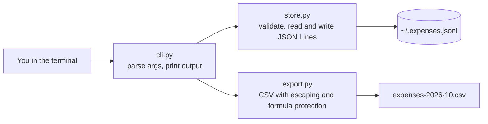

# P1 · Agent-built CLI tool

Build a small, real command-line tool with a coding agent, using the [spec-first, test-first workflow](../../01-coding-agents/agentic-sdlc.md). The finished tool is here so you can compare, but the point is to rebuild it yourself and practise directing an agent.

**Covers:** [01 · Coding agents](../../01-coding-agents/README.md) · **Level:** Beginner · **Time:** 3 to 4 hours

## What you'll build

`expenses`, a terminal expense tracker with `add`, `list`, `summary` and CSV `export` commands. It's deliberately small, so you can review every line the agent writes.



## What's in this folder

| File | Purpose |
|---|---|
| [SPEC.md](SPEC.md) | The spec given to the agent, with testable acceptance criteria |
| [AGENTS.md](AGENTS.md) | Project rules the agent reads every session |
| [.agents/skills/add-command/SKILL.md](.agents/skills/add-command/SKILL.md) | A [skill](../../01-coding-agents/skills.md) for adding new commands the project's way |
| [tests/test_acceptance.py](tests/test_acceptance.py) | One test per acceptance criterion, written before the code |
| [REFLECTION.md](REFLECTION.md) | What the agent got wrong, and how each mistake was caught |
| `src/expenses/` | The implementation |

## Run the finished version

You need Python 3.12+ and [uv](https://docs.astral.sh/uv/getting-started/installation/).

```bash
cd projects/p1-agent-built-cli
uv sync
uv run pytest -q          # 20 tests, no API keys needed

export EXPENSES_FILE=/tmp/expenses.jsonl
uv run expenses add 2026-10-03 food 450.50 --note "team lunch"
uv run expenses add 2026-10-04 travel 1200 --note "cab, airport"
uv run expenses summary --month 2026-10
uv run expenses export --format csv --month 2026-10
```

## Rebuild it with your agent

Start a new empty folder. Copy only `SPEC.md` and `AGENTS.md` into it. Then work through these steps with any [coding agent](../../01-coding-agents/tool-comparison.md).

1. **Read the spec.** Change one thing to make it yours (a new category, a different default currency).
2. **Plan without code.** Prompt:

   ```text
   Read SPEC.md and AGENTS.md. Propose a plan: files, functions, and the order you'll build them.
   Don't write any code yet.
   ```

   Check the plan for floats used for money and for logic placed in the CLI layer. Correct it.
3. **Tests first.** Prompt:

   ```text
   Write tests/test_acceptance.py with one test per acceptance criterion in SPEC.md, named test_acN_....
   Don't implement anything. Run the tests and show me that they fail.
   ```

   Read every assertion. Would it fail if the feature were broken?
4. **Implement.** Prompt: `Implement until all tests pass. Then run ruff. Show me the diff and stop.`
5. **Review like an attacker.** Ask yourself and the agent: "Who opens the CSV, and with what? What inputs could break validation?" Compare what you find with [REFLECTION.md](REFLECTION.md).
6. **Add a skill.** Copy `.agents/skills/add-command/` into your project (or your agent's skills folder), then ask: `Add a "delete" command that removes the most recent expense.` Watch whether the agent follows the skill's steps.
7. **Write your own reflection.** At least three things the agent got wrong and how you caught them.

## Using a different agent

Every major agent reads `AGENTS.md`, either directly or through a one-line import. Skill folders differ by tool:

| Agent | Where skills go |
|---|---|
| Claude Code | `.claude/skills/` (or import `AGENTS.md` from `CLAUDE.md`) |
| OpenAI Codex | `.agents/skills/` |
| Antigravity, Cursor, Copilot, Kiro | See each tool's docs. Most accept the open [Agent Skills](https://agentskills.io/home) format |

## What you learned

- Writing acceptance criteria an agent and a test can both check.
- Reviewing a plan before code, and tests before implementation.
- Turning repeated corrections into `AGENTS.md` rules and skills.
- Spotting a security issue (CSV injection) that wasn't in the spec.

## Threat model (short)

| Risk | Where | Mitigation in this project |
|---|---|---|
| Formula injection in exported CSV | `export.py` | `safe_cell()` prefixes risky cells; AC6 test |
| Corrupt or hostile data file | `store.py` | Strict parsing with a clear error and line number |
| Agent edits outside the project | Agent session | `AGENTS.md` rule plus your agent's permission settings |

**Next:** [02 · Building agents](../../02-building-agents/README.md)
