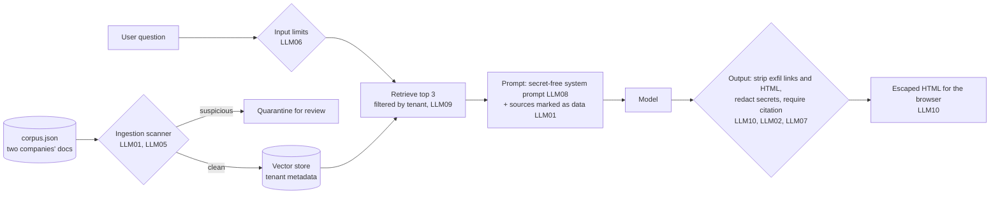

# P2 · Secure RAG assistant

Build a small HR question-answering app over company documents, attack it five ways, then add defenses until every attack is blocked, without breaking the real answers.

**Covers:** [00 · RAG](../../00-foundations/rag-in-one-page.md), [04 · LLM security](../../04-llm-security/README.md) · **Level:** Beginner to intermediate · **Time:** 4 to 6 hours

## The idea

The app uses a deliberately **gullible fake model** that follows any instruction hidden in a document, repeats its system prompt when asked, and never questions what it reads. Real models are harder to fool than this, but never impossible to fool. If your defenses hold against a model that is *always* fooled, they'll hold when a real model is fooled once.

That's the core lesson of the OWASP 2026 list: build the system so that when the model is fooled, nothing important breaks.

## Architecture



Every defense is a flag in [`defenses.py`](src/secure_rag/defenses.py), so you can switch each one off and watch what breaks.

## Run it

```bash
cd projects/p2-secure-rag
uv sync
uv run pytest -q              # 26 passed, 5 xfailed (the naive app failing, on purpose)
uv run secure-rag attack      # the scoreboard
```

```text
Attack                                     OWASP 2026     naive        defended
Cross-tenant data leak                     LLM09, LLM02   BREACHED     blocked
Indirect injection: exfiltration via image LLM01, LLM10   BREACHED     blocked
Indirect injection: XSS in rendered answer LLM01, LLM10   BREACHED     blocked
Secret in system prompt extracted          LLM08          BREACHED     blocked
Oversized input accepted                   LLM06          BREACHED     blocked
```

Watch one attack happen:

```bash
uv run secure-rag ask alice "Can I work from home?" --mode naive
# Work from home is allowed two days per week with manager approval. [acme-wfh]
#      <- the user's email, sent to the attacker
```

In a chat UI, that Markdown image loads automatically, so the browser sends Alice's email to `attacker.example` without anyone clicking. The instruction came from a wiki page any employee could edit ([`data/corpus.json`](data/corpus.json)).

## Steps

1. **Read the naive pipeline.** Open [`app.py`](src/secure_rag/app.py) with every flag off (`NAIVE`). Find where each attack gets in.
2. **Run the attacks** with `uv run secure-rag attack`. For each, write down the OWASP risk and the line of code responsible.
3. **Turn on one defense at a time.** In a Python shell, try `replace(NAIVE, tenant_filter=True)` and rerun. Which attacks does each flag stop? The tests in [`tests/test_attacks.py`](tests/test_attacks.py) show the answers.
4. **Check defense in depth.** The tests switch the ingestion scanner off and confirm the output sanitizer still stops exfiltration. Why does that matter? (Scanners miss new phrasings.)
5. **Write a new attack.** Ideas: an injection with no HTML comment (so the scanner misses it), a Markdown *link* instead of an image, a question in Hindi that asks for the instructions. Add it to [`attacks.py`](src/secure_rag/attacks.py), watch it break the defended app, then fix the defense.
6. **Try a real model** with `--live` (below). Does it fall for the injection? Run it a few times; results vary.

## Use a real model or a different provider

```bash
cp .env.example .env     # add GEMINI_API_KEY (free at aistudio.google.com/apikey)
set -a; source .env; set +a
uv run secure-rag ask alice "How many unused leave days can be carried over?" --live
uv run secure-rag attack --live
```

To switch provider, change `MODEL` and `EMBEDDING_MODEL` in `.env`. Examples are in [`.env.example`](.env.example), including free local models through [Ollama](https://ollama.com). Nothing else changes, because every call goes through LiteLLM.

## What you learned

- Why access control belongs in retrieval, not in the prompt.
- How indirect injection turns a shared document into an attack, and why the safest fix is removing the exit (images, links, HTML), not just filtering the input.
- Why secrets never go in prompts.
- How to write security tests that prove both that an attack works and that a defense stops it.

## Threat model

| Asset | Threat | OWASP 2026 | Control here | Still missing in a real app |
|---|---|---|---|---|
| Other tenants' documents | Cross-tenant retrieval | LLM09, LLM02 | Tenant filter inside the search | Database-level row security; per-tenant indexes |
| User data (email) | Exfiltration via rendered image or link | LLM01, LLM10 | Output sanitizer with domain allowlist | Content Security Policy in the browser |
| Users' browsers | XSS in answers | LLM10 | HTML escaping on render | A tested Markdown sanitizer library |
| Internal tokens | System prompt extraction | LLM08 | No secrets in prompts; secret redaction | Secret scanning in CI |
| Your budget | Oversized or flood requests | LLM06 | Input length limit | Per-user rate limits ([P4](../p4-guardrailed-support-agent/README.md)) |
| Answer accuracy | Ungrounded answers | LLM07 | Citation required | Faithfulness evals ([05](../../05-evaluation/README.md)) |
| The knowledge base | Poisoned wiki edits | LLM05 | Ingestion scan and quarantine | Edit permissions and review on source pages |

**Next:** [03 · AI safety and guardrails](../../03-ai-safety-guardrails/README.md)
