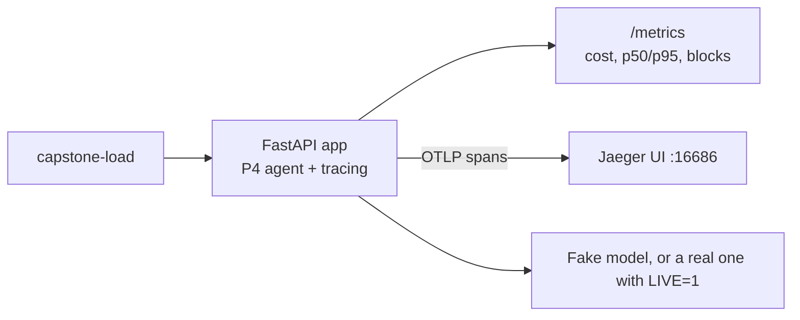

# P5 · Production capstone

Take the [P4 support agent](../p4-guardrailed-support-agent/README.md) to production without changing its code: OpenTelemetry tracing, cost and latency metrics, a load test, a hardened container, a threat model and a design doc.

**Covers:** [07 · Agent ops](../../07-agent-ops-production/README.md), [08 · System design](../../08-ai-system-design/README.md), [LLM06 unbounded consumption](../../04-llm-security/unbounded-consumption.md) · **Level:** Intermediate · **Time:** 5 to 7 hours

## What's here

| File | Purpose |
|---|---|
| [`src/capstone/tracing.py`](src/capstone/tracing.py) | Wraps P4's model client, tools and agent with OpenTelemetry spans using GenAI attribute names. No message text in spans |
| [`src/capstone/app.py`](src/capstone/app.py) | P4's API plus `/metrics` (requests, blocks, p50/p95 latency, cost per user) |
| [`src/capstone/loadtest.py`](src/capstone/loadtest.py) | Async load test mixing normal traffic with attacks |
| [`Dockerfile`](Dockerfile), [`docker-compose.yml`](docker-compose.yml) | Locked dependencies, non-root user, health check, read-only filesystem, Jaeger for traces |
| [`DESIGN.md`](DESIGN.md) | Design doc: targets, shape, data and action paths, trade-offs |
| [`THREAT_MODEL.md`](THREAT_MODEL.md) | Twelve threats, each with a risk ID, decision and test |



## Run it

```bash
cd projects/p5-production-capstone
uv sync
uv run pytest -q          # 5 tests: trace shape, no PII in spans, metrics, load behavior
uv run capstone-load      # in-process load test, no server or API key needed
```

```text
requests:     45 in 0.06s (716 req/s)
status codes: {200: 30, 429: 15}
latency ms:   p50=3.5  p95=6.8  max=50.7
server cost:  $0.000918 (estimated)
```

Three demo users each send 15 requests against a limit of 10 per minute, so 15 get HTTP 429. That's the rate limiter working.

**With Docker and a trace viewer:**

```bash
docker compose up --build
# in another terminal:
uv run capstone-load --url http://localhost:8000
curl -s localhost:8000/metrics
open http://localhost:16686        # Jaeger: service "support-agent"
```

In Jaeger, open a `support_request` trace. You'll see the model calls with token counts and the tool call as child spans, and no message text anywhere.

## Steps

1. **Read [`DESIGN.md`](DESIGN.md)** before the code. Could you defend each trade-off in an interview?
2. **Run the load test** and read `/metrics`. Change `requests_per_minute` in `app.py`'s `Gateway()` and watch the 429s change.
3. **Find the trace** for a blocked jailbreak in Jaeger. Which attribute tells you why it was blocked?
4. **Go live** with `LIVE=1` (below) and rerun the load test at low volume. How much do p95 latency and cost change compared with the fake model?
5. **Close an open item** from [`THREAT_MODEL.md`](THREAT_MODEL.md): add secret scanning to CI, or move rate-limit counters to Redis and run two workers.
6. **Add an alert.** Write down the rule you'd use: for example, guardrail block rate above 20% for 10 minutes, or below 0.1% for an hour.

## Use a real model or a different provider

```bash
cp .env.example .env      # add GEMINI_API_KEY (free at aistudio.google.com/apikey), set LIVE=1
set -a; source .env; set +a
uv run uvicorn capstone.app:app
uv run capstone-load --url http://localhost:8000 --users 2 --requests 5   # stay inside free-tier limits
```

For Docker, uncomment `LIVE` and `GEMINI_API_KEY` in `docker-compose.yml`. Change `MODEL` for OpenAI, Anthropic, or a local Ollama model.

## What you learned

- Adding observability around existing code with OpenTelemetry, without leaking personal data.
- Measuring cost and latency percentiles, and seeing rate limits work under load.
- Packaging an AI service safely: locked dependencies, non-root user, health checks, secrets from the environment.
- Writing a design doc and a threat model where every risk has a decision and a test.

**Next:** [08 · AI system design case studies](../../08-ai-system-design/README.md), then [09 · Careers](../../09-careers-2027/README.md)
