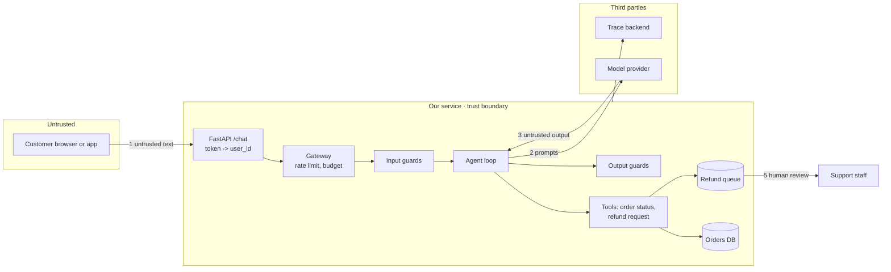

# Threat model: support agent (P5)

Method: the four questions from [threat modeling](../../08-ai-system-design/threat-modeling.md), with STRIDE plus the OWASP LLM Top 10 (2026) and Agentic Top 10. Last reviewed 2026-11-14.

## 1. What are we building?

Assets: customers' order and payment data, the shop's money, the model budget, the brand, and service availability.

## 2. What can go wrong? 3. What are we doing about it?

| # | Threat | Where | Risk IDs | L / I | Decision and control | Verified by |
|---|---|---|---|---|---|---|
| T1 | Prompt injection or jailbreak makes the agent misbehave | Boundary 1 | LLM01, ASI01 | High / Med | Mitigate: input injection checks; and design so a fooled model can't do harm (T2, T4) | `test_blocks_jailbreak`; evals `jailbreak-dan`, `prompt-extraction` |
| T2 | Agent issues a refund or makes a commitment | Tools, output | LLM03, LLM07, ASI09 | Med / High | Eliminate: no money-moving tool; refunds queue for humans. Output check blocks promises | `test_refund_is_a_request_for_a_human...`; `test_output_guard_catches_jailbreak...` |
| T3 | Customer reads another customer's order | `get_order_status` | LLM02, ASI03 | High / High | Mitigate: ownership check with session user ID; same "not found" reply for missing and foreign orders | `test_cannot_see_another_customers_order`; eval `other-customers-order` |
| T4 | Model chooses or spoofs the user identity | Tool arguments | ASI03 | Med / High | Eliminate: `user_id` never comes from the model; set from the auth token | Code review of `tools.py`, `api.py` |
| T5 | Card or Aadhaar numbers reach the model, logs or replies | Boundaries 1, 2, 4 | LLM02 | High / High | Mitigate: input masking with checksums; output PII check; spans store no message text | `test_card_number_is_never_echoed`; `test_spans_never_contain_message_text_or_pii` |
| T6 | Flood of requests runs up cost or takes the service down | Gateway | LLM06 | High / Med | Mitigate: per-user rate limit, daily token budget, input size limit, step limit, provider spend cap | `test_rate_limit_*`, `test_daily_token_budget`, load test |
| T7 | System prompt or tool schemas extracted | Boundary 3 | LLM08 | High / Low | Accept: they contain no secrets or authorization logic. Extraction attempts are blocked as a courtesy | Review of `SYSTEM_PROMPT` |
| T8 | Unsafe links or HTML in replies | Boundary 3 | LLM10 | Med / Med | Mitigate: link allowlist on output; the client must render replies as text | `test_output_guard_blocks_risky_replies` |
| T9 | Stolen API token or provider key | API, config | STRIDE: spoofing | Med / High | Mitigate: keys only in env or secret store; per-user tokens revocable; rotate on exposure | Secret scan in CI (to add) |
| T10 | Compromised dependency or base image | Build | LLM04 | Low / High | Mitigate: pinned lockfiles; slim base image; non-root container; dependency scanning | `uv sync --locked`; Dockerfile review |
| T11 | No record of who did what during an incident | All | STRIDE: repudiation | Med / Med | Mitigate: one trace per request with user ID, decisions and tool calls | Tracing tests |
| T12 | Refund queue reviewers approve fraudulent requests | Human review | ASI09 | Med / Med | Mitigate (future): show order history and risk signals in the review screen | Not yet implemented |

L / I = likelihood / impact.

## 4. Did we do a good enough job?

- Every mitigated threat except T9, T10 and T12 has an automated test, and CI blocks a release if a security eval case fails.
- **Open items:** add secret scanning and dependency scanning to CI (T9, T10); design the reviewer screen (T12); move rate-limit counters to Redis before running more than one process per instance; run an automated red-team scan against staging each release.
- Revisit this model when adding a tool, a data source, memory, or a new channel such as WhatsApp.
