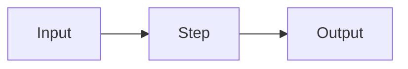

<!-- Copy this file into a module folder, rename it (lowercase-with-dashes.md), and fill in every section.
     Keep it under ~800 words. If it grows past that, split it into two notes.
     Read STYLE.md before writing. -->

# Short, plain title

## In one sentence

One sentence a newcomer can repeat to a friend. Put the main **term** in bold and add it to [the glossary](../glossary.md).

## Why it matters in 2027

Two or three lines on why an AI engineer needs this now. Be specific: what breaks, costs money, or gets asked in interviews if you don't know it.

## Explain it like I'm new

An everyday analogy. Then one sentence on where the analogy stops working.

## How it works

The real explanation, in short paragraphs or steps. Add a diagram if it helps:

> [!NOTE]
> Use GitHub alerts for side notes: `[!NOTE]`, `[!TIP]`, `[!IMPORTANT]`, `[!WARNING]`, `[!CAUTION]`.

## Example

A concrete, short example: a prompt, an attack, a snippet of code, or a real incident with a source.

## Common mistakes

- Mistake, and what to do instead.
- Mistake, and what to do instead.

## Check yourself

1. Question one?
2. Question two?
3. Question three?

Answers

1. Answer one.
2. Answer two.
3. Answer three.

## Go deeper

- [Source title](https://example.com) - What you'll get from it. *Beginner · Article · 10 min*
- [Source title](https://example.com) - What you'll get from it. *Intermediate · Video · 30 min*
